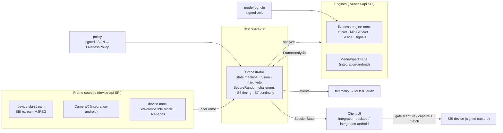

# mosip-vivid

Face liveness and presentation attack detection (PAD) for the MOSIP Desktop and Android Registration Clients.
It is vendor-neutral, works offline first, and was built for MOSIP Decode 2026, problem statement 04.

mosip-vivid plugs into both Registration Clients through two small interfaces: a **frame source** for any
L0/L1 device and a **liveness engine** that only scores frames. A single orchestrator fuses several independent
anti-spoofing signals into one auditable decision. It runs a hands-free passive-to-active challenge flow for
resident capture, operator authentication and supervisor authentication, with the same behaviour online and
offline. A TLA+ model checks the state machine: no path reaches `PASSED` unless the policy's score, PAD,
identity-continuity and challenge-count conditions all hold.

## Architecture



The full design is in [`docs/design/`](docs/design/). The key decision is that **engines score and the
orchestrator decides**. This keeps behaviour identical across engines, platforms and vendors, and makes the
decision logic small enough to model-check. The reasons are in [01-architecture §5](docs/design/01-architecture.md).

## Modules and status

Status meanings:
- **implemented**: code and tests in this repository.
- **source-only**: code present but not yet verified end to end, or not yet built by the root reactor.
- **designed**: specified in `docs/design/` only.

`mvn install` at the root builds and tests every Java module below. The ONNX models are not committed. Fetch them
as described in [`liveness-engine-onnx/models/README.md`](liveness-engine-onnx/models/README.md). Tests that need
them are skipped when they are absent.

| Module | Purpose | Status | Tests |
|---|---|---|---|
| `liveness-api` | Engine and session SPI, policy, state, result DTOs | implemented | compile-checked contract |
| `device-api` | `FaceFrameSource` SPI, `FaceFrame`, capabilities, health | implemented | compile-checked contract |
| `liveness-core` | Orchestrator, fusion, challenge selection, action verification, unprompted-action check, identity continuity, evidence hash | implemented | 109 |
| `policy` | Policy JSON, validation, properties flattening, signing (`PolicyKeyTool`) | implemented | 48 |
| `telemetry` | `LIVENESS` audit events, diagnostics, anonymised metrics, offline audit queue | implemented | 19 |
| `model-bundle` | `.mlb` bundle format, signature and hash verification, store with rollback (`BundleTool`) | implemented | 29 |
| `liveness-engine-onnx` | Desktop engine on ONNX Runtime: YuNet, MiniFASNet-family anti-spoof, SFace, signals S1–S9 including S8 depth/IR, per-subject pitch baseline, opt-in GPU/accelerator execution providers with CPU fallback | implemented; S8 tested on synthetic depth/IR only; only the CPU path has run | 91 (2 skipped) |
| `device-mock` | SBI-compatible mock face device, synthetic face renderer, scenario replay, fault injection, synthetic depth/IR planes, signed preview stream with tampering modes | implemented | 39 |
| `device-sbi-stream` | Desktop SBI `/stream` adapter with ring buffer, stall detection and reconnect | implemented; interoperates with MOSIP's reference MockMDS 1.2.0.2 on every verb used, including face streaming ([report](docs/testing/interop-mockmds.md)); verifies the proposed signed preview stream; not tried on vendor hardware | 51 (13 opt-in MockMDS tests) |
| `testkit` | ISO/IEC 30107-3 metrics with Wilson intervals, non-response rates and group slices (`IsoReportMain`), corpus scorer (`CorpusScoreMain`), conformance suite, scenario runner | implemented | 41 |
| `integration-desktop` | Registration Client glue: liveness gate, capture binding, JavaFX overlay, i18n, core wiring | implemented; the 7 patches apply to and compile against `registration-client` `release-1.2.0.x` ([report](docs/testing/desktop-mosip-compile.md)); not started inside a running client | 87 |
| `e2e-tests` | Real core + real ONNX engine + mock device, scripted scenarios and closed-loop challenge trials | implemented | 10 |
| `integration-android` | Kotlin CameraX source, MediaPipe/TFLite engine, Pigeon bridge, Flutter overlay | 8 patches apply to `android-registration-client` `release-1.2.x` and the patched app builds a debug APK, including operator face matching against the enrolled face ([report](docs/testing/android-arc-integration.md)); not run on a device | 28 Kotlin, 5 Flutter |
| `demo-desktop` | Attack Lab: Swing demo on the real core and engine, live attack switching, headless recorder | implemented | 6 |
| `liveness-av` | Spoken-code audio-visual liveness: random 4-digit code read aloud, offline Vosk digit recognition, lip/audio synchrony; carried on the `HOLD_STILL` challenge through the existing SPI | prototype; tested with synthetic speech and lip tracks only, not wired into either client UI ([results](docs/testing/av-liveness.md)) | 54 |
| `calibration` | Server side of privacy-preserving threshold calibration: aggregates differentially private score histograms, re-estimates thresholds, emits signed policy updates (client side in `telemetry`) | implemented; simulated, no MOSIP sandbox ([design](docs/design/14-dp-calibration.md)) | 6 |
| `device-vendor-sdk` | Template adapter for vendors that ship their own SDK instead of SBI, with a vendor guide | implemented; passes the conformance suite with a fake SDK | 11 |
| `formal/` | TLA+ model of the orchestrator, checked with TLC | implemented | see below |
| `docs/` | Technical design, UX spec and mock-ups, test plan, corpus ethics, submission pack, platform reconnaissance | implemented | none |

### End-to-end results

The `e2e-tests` module drives the real orchestrator and the real ONNX engine with the mock device's drawn faces.
A simulated person reacts to each prompt after 700 ms. A simulated replay performs a fixed gesture schedule and
ignores prompts. Challenge draws are seeded, so these counts reproduce.

| Policy | Live subject passes | Replay passes |
|---|---|---|
| Two challenges | 30 of 30 | 5 of 30 |
| Three challenges | 30 of 30 | 0 of 30 |

These runs found and fixed four defects in the core and engine. They also showed that a drawn face cannot test
passive PAD. The details and every limitation are in [`docs/testing/e2e-findings.md`](docs/testing/e2e-findings.md).

### Proxy evaluation on real faces

No consented corpus of real people was collected. As the closest honest substitute, 39 adults in openly licensed
video (Wikimedia Commons CC0/CC BY/CC BY-SA and public-domain US Government footage) were run through the real
orchestrator and engine as bona fide presentations, against five digitally simulated attack species (234
presentations). This is a digital proxy, not ISO/IEC 30107-3 physical-instrument testing; no media is in the
repository. Full method and results: [`docs/testing/proxy-eval/`](docs/testing/proxy-eval/README.md).

| Passive only (resident, threshold 0.80) | Result |
|---|---|
| BPCER (real people rejected) | 5.7 % (2/35) |
| APCER, simulated screen photo / screen replay | 28 % / 44 % |
| APCER, simulated prints (flat, warped, cut-out) | 83–84 % |
| With challenges | every attack fails (APCER 0 %) |

Passive checks alone do not stop prints, so resident capture now challenges every time (`ALWAYS`), and the
pulse signal (S4), which fired on real skin, no longer vetoes on its own. The evaluation also showed head-tilt
and gaze readings on real faces are too noisy for the nod and look-up/down challenges, which stay out of the
default pool.

### Formal verification result

TLC checked [`formal/LivenessOrchestrator.tla`](formal/LivenessOrchestrator.tla) in two configurations. All eight
invariants and three temporal properties hold, including `PassedImpliesPolicy`, `NoPassAfterVeto`,
`AttemptsBounded`, `TerminalIsFinal` and `EventuallyTerminal`:
- Default configuration: 26,061 states generated, 6,955 distinct, depth 15.
- Supervisor configuration: 44,783 states generated, 11,463 distinct, depth 18.

The hand-written Java orchestrator is checked against the spec by trace conformance: a Java copy of the spec's
transition relation, verified to reach exactly TLC's state graph, drives random walks that are replayed against the
real `LivenessOrchestrator`, and the two states must agree after every step (about 200,000 steps, all 31 phase
transitions, all 14 failure reasons; `formal/conformance.sh`). This found two real bugs, both fixed: a session could
pass after its last challenge with a fused score below threshold, and a retry after a device failure skipped device
reconnection. Phase and transition tables are generated from the spec and CI fails if they drift.

Seven deliberate bugs injected into the spec were each caught. Details are in [`formal/README.md`](formal/README.md).
CI re-runs TLC on every push.

## Quick start

Prerequisites: JDK 17 or newer and Maven 3.9+ to build. The modules that ship inside the clients compile to Java 11
bytecode, so they load on the Java 11 runtime of Registration Client 1.2.0.x. You need no hardware and no MOSIP server.

The fastest way to see it working is the Attack Lab (models must be fetched first, see below):

```sh
mvn -B -ntp install                                  # builds everything, runs all tests
java -jar demo-desktop/target/vivid-demo.jar         # window: pick a workflow and an attack, watch the decision
java -Djava.awt.headless=true -jar demo-desktop/target/vivid-demo.jar --record out --scenario demo-reel   # PNGs + AVI
```

Screenshots and a about 60-second silent recording are in [`docs/demo/`](docs/demo/) (the `.avi` is git-ignored and is
shared with the submission). The mock device alone:

```sh
# 1. Build (reactor: the two SPIs; then each module you want to run)
mvn -B -ntp install
mvn -B -ntp -f policy/pom.xml install
mvn -B -ntp -f telemetry/pom.xml install
mvn -B -ntp -f device-mock/pom.xml install
mvn -B -ntp -f liveness-core/pom.xml install

# 2. Start the mock SBI face device on 127.0.0.1:4501
java -jar device-mock/target/device-mock-0.1.0-SNAPSHOT.jar --list                 # bundled scenarios
java -jar device-mock/target/device-mock-0.1.0-SNAPSHOT.jar --port 4501 --scenario live-blink-smile-turn

# 3. Switch the device to an attack while it runs (what attack-lab automates)
curl -X POST http://127.0.0.1:4501/mock/scenario -d '{"scenario":"print-attack"}'
curl http://127.0.0.1:4501/mock/status
```

The bundled scenarios include `live-pass`, `live-blink-smile-turn`, `print-attack`, `screen-replay`,
`video-replay`, `multiple-faces`, `no-face`, `stall` and `disconnect-mid-session`.

**Demo entry point: `demo-desktop`** (the Attack Lab). A judge picks a workflow and a subject (live person,
printed photo, video replay, screen replay, injected stream) and can switch to an attack mid-session. The live
preview, prompts, per-signal scores, decision, evidence hash and audit trail update as the real orchestrator and
ONNX engine run. See [`demo-desktop/README.md`](demo-desktop/README.md).

Running TLC yourself:

```sh
curl -fsSL -o tla2tools.jar https://github.com/tlaplus/tlaplus/releases/download/v1.8.0/tla2tools.jar
cd formal && java -cp ../tla2tools.jar tlc2.TLC -config LivenessOrchestrator.cfg LivenessOrchestrator.tla
```

## Configuration summary

Policy is a single signed JSON document. It can also be flattened into `mosip.registration.liveness.*` keys, so it
travels through the existing Registration Client config sync. The defaults are compiled in, so liveness is enforced
even before the first sync. Precedence is:
1. The signed document.
2. Local properties, which can only tighten the policy.
3. Compiled defaults.

If the signature fails to verify, the client falls back to the compiled defaults, never to "disabled".

| Workflow | Passive threshold | Active mode | Challenges (min–max) | Max attempts | On max attempts |
|---|---|---|---|---|---|
| RESIDENT | 0.80 | ALWAYS (`ON_LOW_CONFIDENCE` supported) | 2–3 | 3 | ASSISTED_CAPTURE_WITH_SUPERVISOR |
| OPERATOR | 0.85 | ALWAYS | 2–3 | 3 | LOCK_AND_ALERT |
| SUPERVISOR | 0.90 | ALWAYS | 3 | 2 | LOCK_AND_ALERT |

Every key, its default and its tightening direction are listed in [07-configuration](docs/design/07-configuration.md).

## Documentation

| Topic | Document |
|---|---|
| Architecture, the two SPIs, data flow | [docs/design/01-architecture.md](docs/design/01-architecture.md) |
| Frame streaming, unsigned-stream gap, SBI signed-preview proposal | [docs/design/02-frame-streaming.md](docs/design/02-frame-streaming.md) |
| Liveness and PAD signals S1–S9, fusion, hard veto | [docs/design/03-liveness-and-pad.md](docs/design/03-liveness-and-pad.md) |
| Passive-to-active flow, challenge selection, accessibility | [docs/design/04-passive-to-active-flow.md](docs/design/04-passive-to-active-flow.md) |
| Resident, operator and supervisor sequence diagrams | [docs/design/05-workflows.md](docs/design/05-workflows.md) |
| Online and offline architecture | [docs/design/06-online-offline.md](docs/design/06-online-offline.md) |
| Configuration design and keys | [docs/design/07-configuration.md](docs/design/07-configuration.md) |
| Error handling (all 13 cases) and recovery | [docs/design/08-error-handling.md](docs/design/08-error-handling.md) |
| Security (STRIDE) and privacy (DPIA summary) | [docs/design/09-security-privacy.md](docs/design/09-security-privacy.md) |
| ISO/IEC 30107-1/-3 alignment | [docs/design/10-iso-30107-alignment.md](docs/design/10-iso-30107-alignment.md) |
| Model bundles, versioning, offline updates, rollback | [docs/design/11-model-lifecycle.md](docs/design/11-model-lifecycle.md) |
| UX specification, copy, wireframes, accessibility | [docs/design/12-ux-spec.md](docs/design/12-ux-spec.md) |
| UI mock-ups and user flow (SVG and PNG) | [docs/ux/](docs/ux/) |
| Test plan and results template | [docs/testing/test-plan.md](docs/testing/test-plan.md) |
| End-to-end findings, MOSIP client compile and Android app reports, MockMDS interoperability, performance | [docs/testing/](docs/testing/) |
| Consented PAD corpus: ethics, consent form, capture log, evaluation-day runbook | [docs/corpus-ethics.md](docs/corpus-ethics.md), [docs/corpus/](docs/corpus/) |
| Attack Lab screenshots | [docs/demo/](docs/demo/) |
| Formal model and TLC results | [formal/README.md](formal/README.md) |
| Platform reconnaissance | [docs/recon/](docs/recon/) |
| Pitch outline, video script, submission checklist | [docs/submission/](docs/submission/) |
| Upstream drafts: SBI change request, Registration Client PRs, MockMDS issue | [docs/upstream/](docs/upstream/) |

## Honest limits

- No ISO/IEC 30107-3 laboratory evaluation has been done, and none is claimed. The only real-face figures are the
  digital proxy above. Physical attack instruments and webcam capture are still untested.
- The SBI 0.9.5 preview stream is unsigned. Identity continuity checks the signed capture against the session's face,
  and the proposed signed-preview extension is implemented on both sides (mock device and adapter) and rejects
  modified, replayed, stripped and impostor streams, but no real device implements it yet.
- The Android patches build a debug APK of the real Android client, but it has not run on a phone, and the
  face-match threshold is uncalibrated. The Desktop patches compile against the real client, but have not been
  started inside it.
- `NOD`, `LOOK_UP` and `LOOK_DOWN` pass closed-loop tests only when pitch is read from the drawn landmarks. YuNet's
  landmarks track pitch poorly, and on real faces (proxy evaluation) talking alone moves pitch by 5–10° and vertical
  gaze is unusable, so these three are left out of the default challenge pool.
- S8 depth/IR is tested on synthetic planes only; no depth or IR camera has been used.
- Passive PAD is weak against prints (proxy APCER 83–84 %): only the CNN texture signal separates attacks, and
  moiré did not separate the simulated screens. Security currently rests on challenge-response.
- Signal weights for moiré, colour statistics, rPPG and parallax are hand-set, not trained.
- Spoken-code liveness works with synthetic speech in English and Hindi, partly in Telugu, and not in Gujarati; its
  lip-sync threshold was tuned on synthetic lips and background speech defeats it. It is a prototype.
- The nightly red-team workflow and the calibration loop have run locally only, never in CI or against a MOSIP
  sandbox.

## Contributing, security, conduct

See [CONTRIBUTING.md](CONTRIBUTING.md). PAD bypasses and policy bypasses are security vulnerabilities. Report them
privately as described in [SECURITY.md](SECURITY.md), not as public issues. This project follows the
[Contributor Covenant 2.1](CODE_OF_CONDUCT.md).

## Licence

Mozilla Public License 2.0 ([LICENSE](LICENSE)), the licence MOSIP uses.

## Acknowledgements and model licences

| Component | Licence | File |
|---|---|---|
| YuNet face detector (OpenCV Zoo, Shiqi Yu) | MIT | `liveness-engine-onnx/models/LICENSE-yunet.txt` |
| MiniFASNet anti-spoofing (Silent-Face-Anti-Spoofing, minivision) | Apache-2.0 | `liveness-engine-onnx/models/LICENSE-antispoof.txt` |
| SFace face recognition (OpenCV Zoo) | Apache-2.0 | `liveness-engine-onnx/models/LICENSE-sface.txt` |
| ONNX Runtime | MIT | via Maven |
| MediaPipe Tasks (Android) | Apache-2.0 | via Gradle |
| TLA+ tools (TLC) | MIT | downloaded in CI, not redistributed |

No research-only PAD dataset (OULU-NPU, SiW, CASIA-FASD, CelebA-Spoof) is used for shipped weights or
redistributed. Thanks to the MOSIP team for the Registration Client, the SBI specification and MockMDS, on which
the mock device's protocol is modelled.
