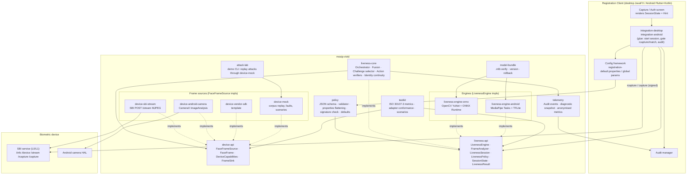
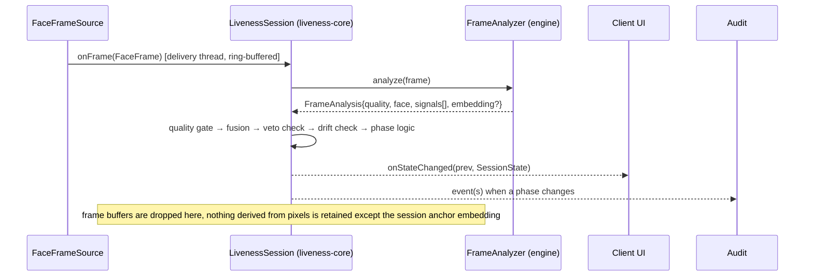

# 01 — Architecture

**Status legend used across `docs/design/`:** *implemented* = code in this
repository with tests; *source-only* = code present but not yet verified end
to end; *as designed* = specified here and in PLAN.md, not yet coded. The
root `README.md` has the per-module status table; this document describes
the intended whole.

## 1. Problem framing

The MOSIP Registration Client (desktop, JavaFX + Spring) and the Android
Registration Client (Flutter + Kotlin) both capture a face through an
SBI-compliant L0/L1 biometric device. Today the client calls `rcapture`,
receives a signed ISO 19794-5 image, runs a quality check and stores the BIR.
Nothing checks that a live person was in front of the device. The problem
statement asks for passive liveness, presentation attack detection (PAD) and
an automatic passive-to-active challenge flow across three workflows
(resident capture, operator authentication, supervisor authentication),
configurable through the existing config framework, working identically
online and offline, and vendor-neutral.

## 2. Component diagram



## 3. Module responsibilities

| Module | Responsibility | Depends on | Must not |
|---|---|---|---|
| `device-api` | The frame-source SPI: `FaceFrameSource`, `FrameSink`, `FaceFrame`, `PixelFormat`, `DeviceCapabilities`, `DeviceHealth`, `StreamOptions`, `DeviceException`. Zero dependencies. | nothing | know anything about liveness. |
| `liveness-api` | The engine and session SPI plus every DTO a client needs: `LivenessEngine`, `FrameAnalyzer`, `FrameAnalysis`, `FaceObservation`, `FaceQuality`, `SignalScore`, `Signals`, `ChallengeType`, `Challenge`, `ChallengeOutcome`, `LivenessPolicy`, `SessionContext`, `LivenessSession`, `SessionState`, `LivenessResult`, `FailureReason`, `Workflow`. | `device-api` | contain logic beyond validation and defaults. |
| `liveness-core` | The orchestrator: implements `LivenessSession`; owns the state machine (`formal/`), the passive window, fusion and hard-veto rule, challenge selection with `SecureRandom` and nonce, action verification from `FaceObservation`, S6 timing, S7 identity continuity from embeddings, retries, timeouts, `LivenessResult` assembly with `evidenceHash`. | `liveness-api`, `device-api` | touch pixels, load models, talk to devices, read configuration files. |
| `policy` | Policy document: JSON schema, validation, per-workflow `LivenessPolicy` construction, flattening to/from `mosip.registration.liveness.*` properties, signature verification, compiled-in defaults. | `liveness-api`, Jackson | be consulted mid-session (policy is captured at `open`). |
| `telemetry` | Audit event catalogue for component `LIVENESS`, diagnostic-mode snapshot, anonymised per-centre metrics aggregator. Publishes through an interface the client integration binds to MOSIP's audit manager. | `liveness-api` | persist frames or embeddings. |
| `model-bundle` | `.mlb` format, manifest, signature and hash verification, compatibility matrix, rollback, offline import. | JDK crypto | load a model it has not verified. |
| `liveness-engine-onnx` | Desktop `LivenessEngine`: YuNet detection, landmarks, MiniFASNet (S1), moiré (S2), colour statistics (S3), rPPG (S4), parallax features (S5 input), MobileFaceNet embeddings (S7 input), depth/IR (S8), quality (S9). | OpenCV, ONNX Runtime, `model-bundle` | decide; it emits `SignalScore`s and `FaceObservation`s only. |
| `liveness-engine-android` | Same contract on MediaPipe Tasks + TFLite with GPU/NNAPI delegates. | MediaPipe, TFLite | diverge in behaviour from the desktop engine for the same policy. |
| `device-sbi-stream` | Desktop adapter for SBI `POST /stream` (multipart MJPEG). Capability discovery via `/info` and `/device`. Ring buffer, stall detection, reconnect with backoff. | `device-api`, JDK HTTP client, OpenCV for decode | block the socket reader. |
| `device-android-camera` | CameraX `ImageAnalysis` adapter, `STRATEGY_KEEP_ONLY_LATEST`, NV21/YUV420. | CameraX | — |
| `device-vendor-sdk` | Template adapter for proprietary preview callbacks, with a fake for tests. | `device-api` | — |
| `device-mock` | Mock L0/L1 device: SBI-compatible HTTP endpoints plus `/stream` replaying a corpus directory; JSON scenario scripts; fault injection. Doubles as the demo device. | `device-api`, JDK HTTP server | — |
| `testkit` | ISO/IEC 30107-3 evaluation harness (APCER per PAI species, BPCER, ACER, BPCER@APCER), adapter conformance suite, scenario runner. | everything above | — |
| `attack-lab` | Demo CLI/desktop tool: pick an attack and a subject, push through `device-mock` into a running client or the console session, show the audit trail. | `device-mock`, `liveness-core` | — |
| `integration-desktop` | Spring beans and controller patches for `mosip/registration-client`: face capture controller, operator and supervisor auth controllers, JavaFX overlay, i18n keys, audit binding. | all | duplicate orchestrator logic. |
| `integration-android` | Kotlin engine wrapper, Pigeon channel, Flutter `LivenessOverlay`, screen integration. | all | duplicate orchestrator logic. |

## 4. The two SPIs

### 4.1 `FaceFrameSource` (device-api)

```java
public interface FaceFrameSource extends AutoCloseable {
    String adapterId();                                  // "sbi-stream", "android-camerax", "mock", ...
    DeviceCapabilities capabilities();                   // vendor, model, deviceId, sbiSpecVersion, L0/L1,
                                                         // resolution, nominalFps, formats, hasDepth, hasIr, signsFrames
    void start(FrameSink sink, StreamOptions options);   // push model, dedicated delivery thread, returns immediately
    void stop();                                         // idempotent; sink.onEnd() exactly once per start
    DeviceHealth health();                               // CONNECTING, CONNECTED, DEGRADED, RECONNECTING, DISCONNECTED, FAILED
}
public interface FrameSink {
    void onFrame(FaceFrame frame);                       // must return quickly
    default void onHealth(DeviceHealth health) {}
    default void onEnd() {}
}
```

`FaceFrame` is immutable, carries `sequence`, `timestampNanos`, `width`,
`height`, `PixelFormat` (`RGB888`, `BGR888`, `NV21`, `YUV420`, `GRAY8`,
`GRAY16`, `MJPEG`), read-only `pixels`, optional `depth` and `ir` planes and
an optional `deviceSignature` that is populated only when the device signs
preview frames (future SBI extension, `02-frame-streaming.md`). Engines must
accept at least `RGB888` and `MJPEG`.

The contract is deliberately minimal: an adapter knows how to get bytes out
of one kind of device and how to say when it cannot. It has no opinion on
faces. That is what makes it vendor-neutral: an L0 webcam-class device, an L1
device with a secure element, an Android camera and a corpus replay all look
the same to the orchestrator.

### 4.2 `LivenessEngine` / `FrameAnalyzer` (liveness-api)

```java
public interface LivenessEngine extends AutoCloseable {
    EngineInfo info();                 // engineId, version, modelBundleId/version, supportedChallenges, signalIds, producesEmbeddings
    FrameAnalyzer newAnalyzer();       // per-session, stateful, single-threaded
    default SelfTestResult selfTest(); // packaged live/attack frames must score as expected
}
public interface FrameAnalyzer extends AutoCloseable {
    FrameAnalysis analyze(FaceFrame frame);   // quality, FaceObservation, List<SignalScore>, optional embedding, processing time
    default void onChallenge(Challenge c) {}  // lets motion signals (parallax) know what to expect
    void reset();
}
```

An engine turns a frame into numbers: a `FaceQuality`, a model-agnostic
`FaceObservation` (box, yaw/pitch/roll, eye and mouth aspect ratios, smile and
brow scores, gaze, optional landmarks and blendshapes) and a list of
`SignalScore`s, each a calibrated attack probability with a confidence, an
optional `hardVeto` and an optional attack class. It may also return an
identity embedding.

### 4.3 `LivenessSession` (liveness-api, implemented by liveness-core)

```java
public interface LivenessSession extends AutoCloseable {
    SessionContext context();
    SessionState feed(FaceFrame frame);    // safe from the device delivery thread
    SessionState tick();                   // advance timers without a frame
    SessionState state();
    boolean retry();                       // only while state().canRetry()
    void cancel();
    LivenessResult result();               // once terminal or FAILED
    void addListener(SessionListener l);   // synchronous on the feeding thread
}
```

## 5. Why decisions live in the orchestrator, not the engine

Every vendor liveness SDK on the market returns a decision. We deliberately
do not let the engine decide, for four reasons that matter to MOSIP:

1. **Identical behaviour across clients and vendors.** The problem statement
   demands the same behaviour for resident, operator and supervisor flows,
   online and offline, on desktop and Android. If the engine decided, two
   engines (ONNX on desktop, TFLite on Android) would have two decision
   procedures to keep in sync. With one orchestrator, the engines only have
   to agree on score calibration, which is testable with golden frames.
2. **Policy is a client concern.** Thresholds, challenge pools, retry limits
   and lock-out behaviour are set by the country through the config
   framework. An engine that decides has to be told the policy, which
   couples every engine to the policy schema. An engine that scores does
   not.
3. **Auditable and formally checkable.** The orchestrator is a small
   deterministic state machine over integers and flags; it is modelled in
   `formal/LivenessOrchestrator.tla` and every change is model-checked in
   CI. A neural network cannot be model-checked; a state machine around it
   can.
4. **Defence in depth and graceful degradation.** Fusion of independent
   signals, the hard-veto rule and identity continuity across passive,
   active and the signed capture are orchestration-level controls. They work
   with any engine, including one that only supplies S1 and S9.

The cost is that engines must expose enough per-frame information for the
orchestrator to verify actions; `FaceObservation` is that information, chosen
so both MediaPipe blendshapes and classical landmark geometry can fill it.

## 6. Data flow



Threading: the adapter's delivery thread calls `feed`; the orchestrator does
its work synchronously (engine inference included) and returns. The adapter's
ring buffer (`StreamOptions.maxQueuedFrames`) drops the oldest frame when the
orchestrator falls behind, so the stream never blocks the socket or camera.
`tick()` is called from a client timer (typically every 250 ms) so timeouts
fire even when no frames arrive, for example while the device is
reconnecting.

## 7. Integration points in the clients (as designed; confirmed in `docs/recon/`)

| Workflow | Where the session starts | What is gated |
|---|---|---|
| Resident face capture | Desktop: the biometric capture controller before the face `rcapture`. Android: the face capture screen before firing the SBI `rcapture` intent. | `rcapture` is only invoked after `PASSED`, and the returned signed image must pass identity continuity against the session anchor before the BIR is stored. |
| Operator authentication | Desktop and Android authentication controllers, face modality, before `capture`. | The 1:1 match proceeds only after `PASSED`. |
| Supervisor authentication | Same controllers with the `SUPERVISOR` workflow and policy. | Same, stricter policy. |

The `LivenessResult` summary (decision, fused score, per-signal scores,
challenge log with nonce, engine and bundle ids, policy version,
`evidenceHash`) is attached to packet metadata where a field exists, and
always to audit.

## 8. Non-goals

* Replacing the SBI `rcapture`/`capture` signed-image path. We gate it; we
  do not replace it.
* Server-side liveness. Everything runs on the client; a server round-trip
  would break the offline requirement.
* Face matching. Identity continuity (S7) is a same-session consistency
  check, not an identification or deduplication function.
