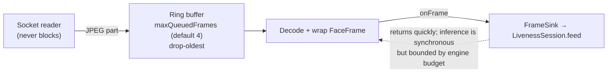
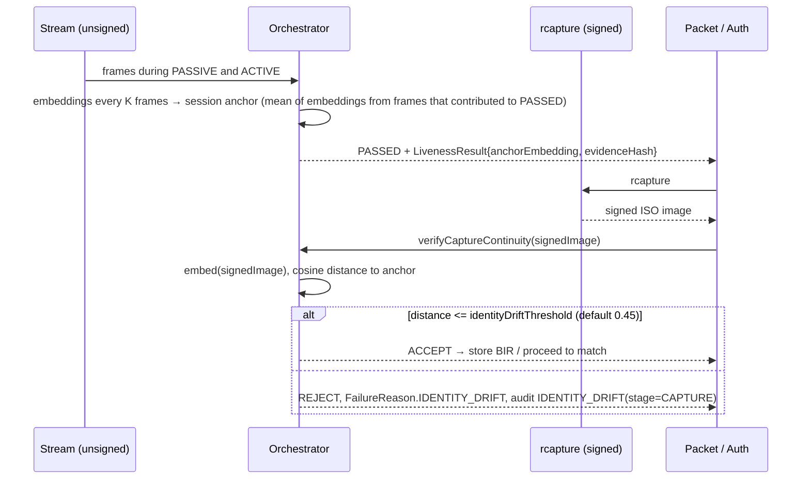

# 02 — Face frame streaming architecture

Covers mandatory task 1 (L0/L1 device integration) and the "face frame
streaming architecture" deliverable. Everything in sections 1–4 is the
behaviour of `device-sbi-stream`, `device-android-camera` and `device-mock`
against the frozen `device-api` SPI; where a module is not yet in the
repository the section says *as designed*.

## 1. Sources of frames

| Platform | Source | Protocol | Signed? | Adapter |
|---|---|---|---|---|
| Desktop | SBI device service, `POST /stream` | `multipart/x-mixed-replace` MJPEG over HTTP on the loopback port the SBI service listens on (4501–4600 range, discovered by probing `/info`) | No (SBI 0.9.5 / 1.0 sign only `capture` and `rcapture` responses) | `device-sbi-stream` (source-only) |
| Desktop, development | `device-mock` | Same endpoints as a real SBI service, plus replay and fault injection | Mock-signed (`deviceSignature` populated when the scenario says so, to exercise the signed-frame path) | `device-mock` |
| Android | Device camera via CameraX `ImageAnalysis` | In-process | No | `device-android-camera` (as designed) |
| Android, vendor | Vendor SDK preview callback | Vendor-specific | Vendor-specific | `device-vendor-sdk` template (as designed) |
| Any | A future L1 device implementing the signed preview extension (section 6) | HTTP chunked or local socket, HMAC per frame | Yes | `device-sbi-stream` with signature verification enabled (as designed) |

## 2. Desktop: SBI `/stream`

### 2.1 Discovery

1. Probe `http://127.0.0.1:{port}/info` for the configured port range, as
   the Registration Client already does. Parse `digitalId` (vendor, model,
   serial, `deviceSubId`), `specVersion`, `certification` (L0/L1), and the
   supported `deviceSubType`s. Only devices advertising `Face` are
   considered.
2. Call `/device` (SBI 1.0 "discover") when available to confirm the device
   is in a `Ready` state.
3. Populate `DeviceCapabilities`: `vendor`, `model`, `deviceId`,
   `sbiSpecVersion`, `certificationLevel`, nominal resolution and fps from
   the stream once the first frame arrives, `formats = {MJPEG, RGB888}`,
   `signsFrames = false`.

Capabilities are cached for the session; a reconnect re-reads them, because
a device can be swapped behind the same port.

### 2.2 Stream consumption

```
POST /stream HTTP/1.1
Content-Type: application/json
{"deviceId":"<id>","deviceSubId":0,"timeout":60000}

HTTP/1.1 200 OK
Content-Type: multipart/x-mixed-replace; boundary=<b>

--<b>
Content-Type: image/jpeg
Content-Length: NNN

<jpeg bytes>
--<b>
...
```

The reader thread parses boundaries, validates `Content-Length` against the
bytes actually read, and hands each JPEG part to a decode stage. Decoding
(JPEG → RGB888 via OpenCV `imdecode`) runs on the delivery thread so that the
socket reader is never blocked by image work; frames the decoder cannot
parse raise `DeviceException.Kind.INVALID_FRAME` and are counted, not
delivered. Frames are also offered undecoded as `PixelFormat.MJPEG` when the
engine declares it accepts them, which avoids a double decode when the engine
needs OpenCV anyway.

### 2.3 Ring buffer and backpressure



Rules:

* The reader thread only ever does: read bytes, find boundary, enqueue.
* The ring buffer has a fixed capacity (`StreamOptions.maxQueuedFrames`); on
  overflow the oldest frame is discarded and a `droppedFrames` counter is
  incremented (visible in diagnostic mode).
* `sequence` numbers are assigned at enqueue time, so the orchestrator can
  see gaps and the S6 timing signal can reason about elapsed frames even
  when some were dropped.
* Target fps (`StreamOptions.targetFps`) is honoured by decimation on the
  consumer side; the SBI stream rate is not controllable.

### 2.4 Fault model

| Fault | Detection | `DeviceHealth` | Session effect |
|---|---|---|---|
| SBI service not running / no face device | `/info` probe fails on all ports | `FAILED(no device)` | `FAILED(DEVICE_UNAVAILABLE)` |
| `POST /stream` refused or non-200 | HTTP error | `FAILED(connection)` | `FAILED(DEVICE_CONNECTION_FAILURE)` |
| Device reports camera busy / not ready | `/device` status or SBI error code in body | `FAILED(camera)` | `FAILED(CAMERA_UNAVAILABLE)` |
| Socket reset, unplug mid-stream | `IOException` on read | `RECONNECTING(reason)` then `CONNECTED` or `DISCONNECTED` | Session pauses (no frames, `tick()` keeps timers); if reconnect succeeds within the challenge timeout the session continues, otherwise `CHALLENGE_TIMEOUT` or `SESSION_TIMEOUT`. If reconnect attempts are exhausted: `FAILED(DEVICE_CONNECTION_FAILURE)`. |
| Stalled stream (no part for `stallTimeoutMillis`, default 3000) | Watchdog on the reader | `DEGRADED(stalled)` then `RECONNECTING` | As above |
| Malformed boundary, zero-length part, bad JPEG | Parser / decoder | `DEGRADED(invalid frames)`; `FAILED` after N consecutive | Frames skipped; after N consecutive `FAILED(INVALID_FRAME_DATA)` |
| Wrong spec version / unsupported sub-type | `/info` parse | `FAILED(protocol)` | `FAILED(DEVICE_UNAVAILABLE)` with audit detail `DEVICE_FAULT(PROTOCOL)` |

Reconnect policy: exponential backoff starting at 250 ms, factor 2, full
jitter, capped at 4 s, at most `StreamOptions.reconnectAttempts` (default 5)
attempts per outage. The UI shows "Reconnecting to device" (hint
`DEVICE_RECONNECTING`) throughout; a reconnect never consumes a liveness
attempt.

## 3. Android: CameraX source (as designed)

* `ImageAnalysis` use case bound to the front camera, target resolution
  640×480, `STRATEGY_KEEP_ONLY_LATEST` (CameraX's own drop-oldest
  backpressure), output `YUV_420_888` converted to `NV21` or `RGB888` through
  libyuv on the analysis thread.
* `DeviceCapabilities` from `CameraCharacteristics`: sensor orientation,
  supported fps ranges, `hasDepth` when a `DEPTH16` stream is available,
  `signsFrames = false`.
* Faults map the same way: camera in use → `CAMERA_UNAVAILABLE`, permission
  denied → `DEVICE_UNAVAILABLE`, `ImageAnalysis` error callbacks →
  `RECONNECTING` with rebinding.
* Thermal: when `PowerManager.getCurrentThermalStatus()` reports
  `THERMAL_STATUS_SEVERE` or worse, the adapter reduces `targetFps` to 10 and
  reports `DEGRADED(thermal)`; the orchestrator disables rPPG for the
  session.

The SBI `rcapture` intent is still used for the final signed image. The
preview and the capture therefore come from different paths; section 5
explains how they are bound.

## 4. Mock device

`device-mock` is an SBI-shaped HTTP server with `/info`, `/device`,
`/stream`, `/rcapture` and `/capture`. `/stream` replays a corpus directory
(video files or image sequences, labelled live / print / screen / replay /
mask / deepfake) as MJPEG. `/rcapture` returns a mock-signed ISO 19794-5
record built from a chosen frame so the identity-continuity binding can be
exercised, including the swap attack. A JSON scenario sequences segments and
faults:

```json
{
  "name": "live-then-photo-then-unplug",
  "steps": [
    {"play": "subjects/s01/live.mp4", "seconds": 3},
    {"play": "subjects/s01/print_a4.mp4", "seconds": 2},
    {"fault": "disconnect", "seconds": 1},
    {"fault": "reconnect"},
    {"play": "subjects/s01/live.mp4", "seconds": 5, "latencyMs": 120, "jitterMs": 40}
  ],
  "rcapture": {"from": "subjects/s02/live.mp4", "frame": 10}
}
```

Faults available: `disconnect`, `reconnect`, `stall`, `corrupt-frames`,
`latency`, `jitter`, `wrong-spec-version`, `multiple-faces` (overlays a
second face), `drop-rate`.

## 5. The unsigned-stream gap and identity continuity

SBI signs `capture` and `rcapture` payloads with the device key. It does not
sign the preview stream, and the Android camera path has no device signature
at all. An attacker who controls the stream path (virtual camera, hooked
driver, man-in-the-middle on loopback) could therefore show a live
accomplice to the liveness check and present a victim's photo to the signed
capture, or the reverse.

mosip-vivid closes this at the orchestration boundary:



* The same check runs *within* the session every K frames (S7), so a face
  swap between passive and active, or mid-challenge, fails the attempt.
* The anchor is kept in memory for the session only and is never written to
  disk; `LivenessResult.anchorEmbedding` exists so the integration can run
  the capture check and is cleared when the session closes.
* The check is a consistency test with a threshold tuned for same-session,
  same-device conditions, not an identification.

What this does **not** cover: an attacker who controls both the stream and
the signed capture at the device level. That is the L1 device's problem
(secure element, signed payloads), and section 6 is the proposal to extend
the same guarantee to the preview.

## 6. Proposal: SBI signed preview frames

### 6.1 Motivation

With a signed preview, the liveness decision would be bound to the same key
that signs `rcapture`, and injection attacks on the preview path (virtual
cameras, replayed streams) would be detectable by signature failure rather
than by heuristics. The change is additive and optional, so existing devices
remain conformant.

### 6.2 Capability advertisement

Inside the (signed) `deviceInfo` payload of `/info`:

```json
"streamSigning": {"supported": true, "alg": "vivid-sp-v1", "deviceKey": "<base64 X.509 SPKI, P-256>"}
```

On an L1 device the key lives in the secure element and is the key certified in `digitalId`. The client either pins
it (`SbiStreamConfig.trustedDeviceKey`) or trusts the advertised key on first use. `DeviceCapabilities.signsFrames`
is true when signing is required by policy, or requested and advertised.

### 6.3 Session key establishment

The client sends an ephemeral P-256 key and a nonce with the STREAM request:

```json
POST /stream
{"deviceId":"<id>","deviceSubId":0,"timeout":60000,
 "signedPreview":{"alg":"vivid-sp-v1","clientKey":"<base64 SPKI>","clientNonce":"<base64 32 bytes>"}}
```

The first multipart part authenticates the device and the session:

```
--<b>
Content-Type: application/json
X-SBI-Part: stream-init

{"alg":"vivid-sp-v1","sessionId":"<uuid>","clientNonce":"<echo>","deviceNonce":"<base64 32 bytes>",
 "signature":"<base64 ECDSA-P256-SHA256 over 'vivid-sp-v1|sessionId|clientNonce|deviceNonce'>"}
```

Both sides derive `sessionKey = HKDF-SHA256(salt = clientNonce || deviceNonce, ikm = ECDH(client, device),
info = "vivid-sp-v1 " + sessionId)`, 32 bytes. Only the holder of the device private key can derive it, and the
echoed client nonce prevents replaying an old session.

### 6.4 Per-frame signature

```
--<b>
Content-Type: image/jpeg
Content-Length: NNN
X-SBI-Frame-Seq: 1234
X-SBI-Frame-Time: 1792840000123
X-SBI-Frame-Signature: <base64 HMAC-SHA256(sessionKey, seq + "|" + time + "|" + hex(SHA-256(jpeg)))>

<jpeg bytes>
```

`SignedPreviewVerifier` (device-sbi-stream) checks the HMAC in constant time and that `seq` strictly increases. A
verified frame carries the HMAC as `FaceFrame.deviceSignature`. A frame that fails any check is delivered without
one, and `FrameSourceBridge` turns an unsigned frame from a signing device into
`LivenessOrchestrator.frameSignatureInvalid`, i.e. `PAD_DETECTED` with attack class `INJECTION`.

**Implemented and tested.** `device-mock` (`MockSbiServer.Builder.signedPreview(true)`) signs with an independent
implementation; `SignedPreviewTest` runs both over HTTP, including four attacks the mock can stage
(`PreviewTamper`): a frame modified after signing, a replayed frame, stripped signature headers, and an impostor
device whose stream-init is signed by a different key. Every attacked frame is rejected; originals still verify.

### 6.5 Binding to `rcapture`

The `rcapture` request gains an optional `streamSessionId`; the device
includes it in the signed `rcapture` response, so the audit record proves the
signed image and the liveness-passing frames came from the same device
session.

### 6.6 Android

The same scheme over a `ContentProvider` or a local Unix socket exposed by
the vendor SBI app, with the frame as a shared-memory buffer and a sidecar
JSON header carrying the same `X-SBI-Frame-*` fields. The HTTP variant is
what `device-mock` and `device-sbi-stream` implement today; the Android
transport is not built.

### 6.7 Cost

One ECDH and one ECDSA verification per stream, one HMAC and one SHA-256 per
frame (microseconds), about 150 bytes of headers per frame, and no change to
existing endpoints. Devices that do not implement it behave exactly as
today.
