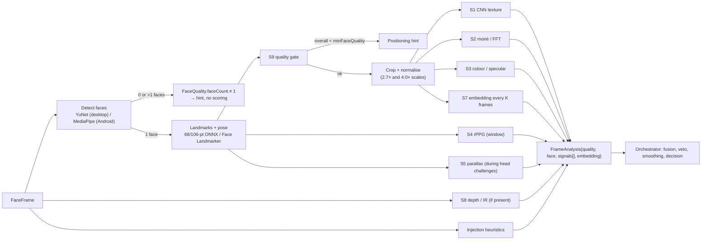

# 03 — Liveness and PAD processing architecture

Covers mandatory tasks 2 (passive liveness) and 3 (PAD) and the evaluation
bullets. The signal inventory follows PLAN.md 4.1; identifiers are the
constants in `io.mosip.vivid.api.Signals`. Per-signal status: the desktop
engine (`liveness-engine-onnx`) is being built signal by signal; the root
README status table says which signals are implemented at any commit. The
fusion, hard-veto rule and smoothing (sections 3–5) are orchestrator
behaviour in `liveness-core`.

## 1. Pipeline per frame



The engine emits one `SignalScore(signalId, attackProbability, confidence,
hardVeto, attackClass)` per enabled signal per frame (or per window for S4).
`attackProbability` is a calibrated probability that the frame comes from an
attack; `confidence` says how much the fusion should trust this signal on
this frame (0 while a window is filling, low when the face is small or dark).

## 2. Signal inventory

Notation: `x` is the normalised face crop, `I` the full frame, `t` the
frame timestamp, `σ` the logistic function, `L` landmarks in normalised
coordinates.

### S1 — CNN anti-spoofing on RGB texture (`cnn_texture`)

* **Measures.** Micro-texture, specular and colour artefacts a convolutional
  network learns to separate live skin from reproductions.
* **Model.** MiniFASNet family. The shipped default is the bundled
  MiniFASNetV2-SE 128 px export (facenox/face-antispoof-onnx, Apache-2.0) on a
  square crop of **1.2×** the detector box's longer side (1.5× until November
  2026), `p1 = 1 − softmax(f(x))_real`.
* **Evaluated and not enabled (November 2026).** The original two-scale
  Silent-Face ensemble (MiniFASNetV2 at 2.7×, MiniFASNetV1SE at 4.0×, 80×80,
  three-class softmax) was converted from the official Apache-2.0 weights and
  run with the upstream preprocessing (BGR, raw 0..255 values, crop kept inside
  the frame). Alone or averaged with the bundled model it separated the proxy
  attacks less well than the bundled model on the training people, and so did
  a mirrored-crop view (test-time augmentation) and a second crop scale. The
  engine still supports up to two models averaged on `P(real)`, the upstream
  crop (`cropMode=fit`) and the mirrored view (`flip`); see
  `docs/testing/proxy-eval/improvement-2026-11.md`.
* **Maths.** With several models, `P(real)` is averaged, then Platt calibration
  `p1' = σ(a·logit(p1) + b)` with `(a, b)` from the model bundle manifest
  (identity when no bundle is installed).
* **Confidence.** `c1 = min(1, boxWidth / 0.25) · sharpnessQuality`.
* **Targets.** Print (A4, glossy), screen replay (phone, tablet, laptop),
  paper mask. Partially: silicone mask.
* **Hard veto.** `p1' > padHardThreshold` (default 0.90) with `c1 > 0.8` on
  three consecutive frames; class from the argmax of the three-way softmax.
* **Android.** Same weights as TFLite int8; GPU delegate when available.

### S2 — Moiré / frequency-domain (`moire`)

* **Measures.** The periodic interference pattern produced by a pixel grid
  re-imaged by a camera sensor.
* **Maths.** Luminance of the crop `Y`, 2-D FFT, radial power spectrum
  `P(r)`. Features: energy ratio in the band `r ∈ [0.25, 0.5]` of Nyquist
  versus `[0.02, 0.25]`, the number and prominence of local peaks in `P(r)`
  above a smoothed baseline, and the anisotropy of the spectrum (peaks in
  the 2-D spectrum at the screen's grid orientations). A logistic model over
  these 6 features gives `p2`. Peak prominence is computed as
  `(P(r_peak) − median(P(r_peak ± 5))) / median(...)`.
* **Confidence.** Falls with blur (moiré is destroyed by defocus) and with
  small crops: `c2 = sharpness · min(1, boxWidth/0.2)`.
* **Targets.** Screen replay (all screen sizes); not prints.
* **Hard veto.** `p2 > 0.97` on three consecutive frames.

### S3 — Specular and colour statistics (`color_stats`)

* **Measures.** Prints are flat reflectors with a compressed dynamic range
  and no specular highlights on the skin; screens shift chromaticity (blue
  excess, gamut clipping) and lack sub-surface scattering.
* **Maths.** Per-channel histograms of the crop in RGB and HSV. Features:
  saturation mean and variance, blue/red ratio in skin pixels (skin mask
  from the landmark polygon), fraction of pixels in the top 2 % of
  luminance (specular proxy), chroma spread (area of the convex hull in
  `(a*, b*)` of CIELAB), and the local-contrast histogram entropy. A
  logistic model gives `p3`.
* **Confidence.** `c3 = illuminationQuality` (the features are meaningless
  under strong colour casts).
* **Targets.** Print, screen.
* **Hard veto.** Not used alone; contributes to fusion only.

### S4 — Remote photoplethysmography (`rppg`)

* **Measures.** The cardiac pulse visible as a periodic change in skin
  colour. A photo, a mask and most replayed or synthesised videos have no
  physiologically plausible pulse.
* **Maths.** Mean green-channel (and the CHROM projection
  `X = 3R − 2G`, `Y = 1.5R + G − 1.5B`) over forehead and cheek ROIs
  defined by landmarks, sampled at the frame rate, detrended, band-passed
  0.7–3 Hz (42–180 bpm), over a sliding window of 5–8 s. Power spectrum
  `S(f)`; `SNR = 10·log10( Σ_{|f−f₀|<0.1} S(f) / Σ_else S(f) )` where `f₀`
  is the dominant peak. `p4 = σ(−k · (SNR − SNR₀))` with `(k, SNR₀)` from
  calibration.
* **Confidence.** 0 until the window has ≥ 4 s of frames with a stable
  face; then rises with window length and falls with head motion (mean
  landmark velocity) and with frame-rate jitter.
* **Targets.** Print, mask, video replay (the replayed person had a pulse
  but it does not survive re-imaging well at low fps, and S6 catches the
  timing), deepfakes (synthesis does not preserve the pulse signal).
* **Policy.** Optional on low-end Android (`signals.rppg.enabled`),
  disabled under thermal throttling.

### S5 — Motion parallax / 3-D structure (`parallax`)

* **Measures.** A planar presentation (print, screen) moves as a homography
  under head rotation; a real face does not.
* **Maths.** During TURN_LEFT/RIGHT, LOOK_UP/DOWN, NOD: take landmark sets
  `L_a` (challenge start) and `L_b` (peak yaw/pitch). Fit a homography `H`
  with RANSAC on the rigid landmarks (eye corners, nose bridge, mouth
  corners, chin). Residual `ρ = median_i ‖ L_b,i − H·L_a,i ‖` normalised by
  inter-ocular distance. A planar surface gives `ρ ≈ 0`; a face gives `ρ`
  proportional to the yaw change. `p5 = σ(−k·(ρ − ρ₀(Δyaw)))` where
  `ρ₀(Δyaw)` is the expected residual for a live face at that yaw change
  (table from calibration).
* **Confidence.** Proportional to `|Δyaw|` achieved (no turn, no
  information); 0 outside a head challenge.
* **Targets.** Print, screen; also cut-out prints and flat masks.
* **Policy.** `requireDepthRevealingChallenge = true` guarantees at least
  one challenge where S5 is informative when `ChallengeType.revealsDepth()`
  is available in the pool.

### S6 — Challenge–response timing (`challenge_timing`, computed by the orchestrator)

* **Measures.** The latency from prompt to action onset and the duration of
  the action.
* **Maths.** `latency = t_onset − t_prompt`; human window
  `[minActionLatencyMillis, maxActionLatencyMillis]` (defaults 150 ms and
  6000 ms). Onset for BLINK is the first frame with `eyeAspect < 0.18`
  after a frame with `eyeAspect > 0.25`; for SMILE `smileScore > 0.6`; for
  head turns `|yaw| > 20°` in the requested direction; for NOD a pitch
  excursion > 12° followed by a return. Actions that begin *before* the
  prompt (anti-replay) or faster than `minActionLatencyMillis` fail the
  challenge with `ACTIVE_CHALLENGE_FAILED`; actions that exceed the window
  time out. `p6 = 1` on a timing violation, `0` otherwise, and the signal
  is informative only during challenges.
* **Targets.** Video replay (a recording cannot react to a random prompt),
  injected deepfakes with generation lag, puppeteering.

### S7 — Identity continuity (`identity`, computed by the orchestrator from engine embeddings)

* **Measures.** Whether the same face is present throughout passive, active
  and the signed capture.
* **Maths.** MobileFaceNet-class embedding `e ∈ ℝ¹²⁸` (112×112 aligned
  crop) every K = 5 frames. Anchor `ā` = running mean of the first N = 3
  embeddings after the quality gate passes, re-normalised. Drift
  `d = 1 − cos(e, ā)`; `p7 = 1` if `d > identityDriftThreshold` (default
  0.45) on two consecutive samples, else `0`. The capture-time check uses
  the same `d` against the signed `rcapture` image.
* **Targets.** Swap attacks between phases, accomplice-then-victim, and the
  unsigned-stream gap described in `02-frame-streaming.md`.
* **Hard veto.** Yes (`IDENTITY_DRIFT`), security-sensitive: generic UI
  message.

### S8 — Depth / IR (`depth`, `ir`; only when the frame carries the plane)

Status: implemented in `liveness-engine-onnx` (`DepthSignal`, `IrSignal`,
thresholds in `DepthIrSettings`) and exercised only on **synthetic** planes,
from unit-test geometry and from the `device-mock` L1 scenarios. No physical
depth or IR camera has been tested; every threshold below is a physics-based
starting point that needs a calibration run on real hardware.

* **Activation.** Both signals are enabled by default (`EngineConfig`
  `ALL_SIGNALS`) but abstain, emitting no `SignalScore` at all, when
  `FaceFrame.depth()` / `ir()` is absent or the buffer is too short for the
  frame size. RGB-only devices therefore get exactly the same
  `FrameAnalysis` as before S8. The analyzer passes the raw frame to signals
  that implement `FramePlaneSignal`. A plane that is present but unusable
  (mostly holes, face out of range) gives a neutral score with confidence 0.
  The engine assumes the planes are registered to the RGB frame. The
  `FaceFrame` contract says "same dimensions"; detector coordinates are
  rescaled if the decoded RGB size differs.
* **Plane format.** Depth is GRAY16, unsigned, `depth.byteOrder` (default
  little-endian, as RealSense Z16 and most UVC depth cameras deliver it),
  `depth.scaleMm` mm per count (default 1), 0 = no measurement, valid range
  `[150, 2000]` mm. IR is GRAY8 (full scale 255) or GRAY16 (same byte order,
  full scale `ir.fullScale16`, default 65535), told apart by buffer length.
  Android `DEPTH16` (three confidence bits on top) must be masked by the
  platform binding first. That is not done yet.
* **Region.** Detector box shrunk to the inner face (12 % off each side, 8 %
  off the top, 5 % off the bottom) and masked by the inscribed ellipse,
  subsampled to about 4 000 points. Depth samples further than 150 mm from
  the region median are dropped as background or flying pixels.
* **Depth maths.**
  1. Noise `σ` from horizontal second differences
     `1.4826 · median|d(x−1) − 2d(x) + d(x+1)| / √6`. A linear tilt cancels
     out.
  2. Least-squares fit of a plane and of a full quadratic in **inverse
     depth** `1/Z` over normalised image coordinates. Under a pinhole camera
     a tilted plane is exactly linear in `1/Z` but not in `Z`, so a 45° print
     fits to quantisation level (< 0.6 mm RMS) instead of leaving millimetres
     of spurious curvature. Residuals are converted back to mm.
  3. Noise-corrected relief `relief = √max(0, rms² − σ²)` for both fits.
  4. Nose protrusion above the quadratic surface:
     `−P10(residual)` in a 0.3 IOD window around the nose landmark, minus the
     `1.28σ` that noise alone gives.
  5. Live evidence `L = ½·min(quadRelief/2.5 mm, 2) + ½·min(nose/6 mm, 2)`,
     raw attack logit `4(1 − L)`, then Platt (`calibration.depth.a/b`).
     The plane relief separates sheets from anything curved. The quadratic
     relief and the nose separate a face from a sheet bent into a cylinder:
     a cylinder is almost exactly quadratic, a nose is not.
* **Depth confidence.** `clip((valid − 0.4)/0.4) · min(1, n/300) ·
  clip(1 − (σ − 4 mm)/8 mm)`. Below 40 % valid pixels the frame says nothing.
* **Depth hard veto.** When plane relief `< depth.vetoPlaneReliefMm`
  (2.0 mm), nose `< 2 mm` and confidence `≥ depth.vetoMinConfidence`
  (0.8), the face region is a sheet and the score carries `hardVeto`
  (class `PRINT`, the planar-instrument class S5 also uses; depth cannot tell
  a print from a screen). This is the depth counterpart of the injection
  veto: a calibrated sensor seeing a plane is physical evidence, not a model
  opinion. A real face is never within 2 mm of a plane over the inner face:
  the synthetic heads give 6.6–10.2 mm. `depth.hardVeto=false` turns it off.
  When the veto condition is not met, the attack probability is capped at
  `depth.maxFusedProbability` (0.85). That keeps model-based verdicts
  (curved sheets, poor coverage) below the orchestrator's generic threshold
  veto (`padHardThreshold` 0.90 at confidence ≥ 0.5, `ScoreFusion`), so they
  are only fused. A policy that lowers `padHardThreshold` below the cap
  turns them into vetoes.
* **IR maths.** On the same region: `level` = median IR as a fraction of
  full scale; `cv` = std / mean **after removing a least-squares linear
  trend**, so the brightness ramp of a tilted, IR-lit print under
  inverse-square fall-off does not read as texture; `glints` = eyes (0–2)
  whose 0.2 IOD window has a pixel ≥ 0.9 of full scale and ≥ 1.5× the window
  median (the emitter's corneal reflection). Raw logit
  `max((0.10 − level)/0.03, (0.06 − cv)/0.018) − glints`, clipped to ±8,
  then Platt. The class is `SCREEN_REPLAY` when the dark term dominates
  (panels emit no NIR), else `PRINT` (many colour inks are NIR-transparent,
  so a print reads as flat paper).
* **IR confidence and veto.** Confidence falls with saturation (0 at 30 %
  clipped pixels) and with few samples. It drops to 0.3 when the whole scene
  is dark (scene P95 < 0.10), because an emitter that is off or blocked looks
  like a screen. IR is a heuristic, not a trained model: it **never vetoes**
  and is capped at `ir.maxFusedProbability` (0.85). When a model bundle
  provides an IR-trained S1-style network, it should replace these features.
* **Results on synthetic planes** (`DepthIrSignalTest`, 23 cases;
  `device-mock` L1 scenarios cross-checked through the engine signals):

  | Presentation | plane relief | quad relief | nose | depth p / veto | IR p (class) |
  |---|---|---|---|---|---|
  | Live head, yaw 0/±25°, pitch −10…15°, σ 1–1.5 mm | 6.6–10.2 mm | 3.2–3.9 mm | 9.7–13.8 mm | 0.04–0.14 | ≤ 0.01 (2 glints) |
  | Live head, σ 4 mm, 25 % holes | 9.7 mm | 3.4 mm | 9.7 mm | 0.13 @ c 0.81 | n/a |
  | Flat or tilted print (0–45°, perspective) | 0 mm | 0 mm | 0 mm | 0.98, **veto** | 0.85 (`PRINT`) |
  | Screen (flat, 10 % glass drop-outs) | 0 mm | 0 mm | 0 mm | 0.98, **veto** | 0.85 (`SCREEN_REPLAY`) |
  | Print bent to a cylinder, R 150/120/100/80 mm | 2.6–5.6 mm | 0 mm | 0 mm | 0.85 (cap), no veto | 0.85 (`PRINT`) |
  | Plane present, 75 % holes / out of range | — | — | — | confidence 0 | — |

* **Curved paper (judgement).** A bent print is not planar, so it does not
  hit the planar hard veto. It has no nose and is developable, so the quad
  relief and the nose term flag it at the 0.85 cap. Fusion then decides,
  usually together with S1 texture, S3 colour and the S8 IR "flat paper"
  reading. We deliberately did not veto on this case: a real face seen at
  low depth resolution (far away, heavy sensor smoothing) can also lose its
  nose detail, and a wrong veto rejects a genuine resident.
* **Limits.** Synthetic data only: no multipath, structured-light shadowing,
  edge flying pixels or temperature drift beyond Gaussian noise and random
  holes. Registration error between the depth/IR sensor and RGB is not
  modelled. A rigid 3-D mask or a head-shaped prop passes depth by design;
  silicone masks may pass IR. Thresholds were not fitted on any corpus.
  `SbiStreamFrameSource` does not carry depth or IR (SBI 0.9.5 streams
  MJPEG only), so today only an in-process adapter or the mock delivers
  these planes.
* **Mock.** `device-mock` scenarios gain an optional `"sensors"` block
  (`SensorConfig`: depth/IR on or off, surface `AUTO|HEAD|FLAT_PRINT|CURVED_PRINT|SCREEN`,
  tilt, bend radius, noise, holes). `MockFaceFrameSource` attaches the
  planes and reports `hasDepth`/`hasIr`. Existing scenarios have no block
  and are byte-for-byte unchanged. Four L1 scenarios
  (`Scenarios.sensorScenarioNames()`: `l1-live-depth-ir`,
  `l1-print-depth-ir`, `l1-curved-print-depth-ir`, `l1-screen-depth-ir`) load
  by name but stay out of `bundledNames()`, so the testkit suite and its
  expectations are untouched.

### S9 — Face quality gate (`quality`; not an attack signal)

Inputs to `FaceQuality`:

| Component | Computation | Hint when low |
|---|---|---|
| `faceCount` | detector output | `ONLY_ONE_FACE`, or `LOOK_AT_CAMERA` when 0 |
| `sharpness` | variance of the Laplacian of the crop, normalised to the resolution; mapped to [0,1] by a calibrated ramp | `HOLD_STILL` |
| `illumination` | mean luminance in [60, 190] of 255 and the fraction of clipped pixels < 5 % | `IMPROVE_LIGHTING` |
| `poseQuality` | 1 − max(|yaw|/35°, |pitch|/25°, |roll|/20°) clipped | `LOOK_AT_CAMERA` |
| `occlusion` | landmark confidence and symmetry of the eye and mouth regions | `CENTER_FACE` |
| `sizeQuality` | inter-ocular distance relative to the ideal band (box width 0.2–0.5 of frame) | `MOVE_CLOSER` / `MOVE_BACK` |

`overall = min(all)` when exactly one face, else 0. The orchestrator stays in
`FACE_ACQUIRING` until `overall ≥ minFaceQuality` (default 0.40) for
`passiveMinFrames` consecutive frames.

### Injection heuristics (`injection`)

Not a presentation attack in ISO terms but in scope for a registration
client. Desktop: enumerate video devices and flag known virtual-camera
driver names (OBS Virtual Camera, v4l2loopback, ManyCam, Snap Camera),
verify that the SBI service's reported `digitalId` serial matches a
USB-attached device when the OS exposes that, detect perfectly constant
frame intervals and identical consecutive frames (replayed files), and
verify `deviceSignature` when the device signs frames. Android: Play
Integrity verdict cached at app start, camera id must be a physical
front-facing camera. Any of these with certainty raises
`SignalScore.veto("injection", "INJECTION")`. The rest contributes a small
weight to fusion.

## 3. Calibration

Each learned signal (S1, S2, S3, S4) outputs a raw score `s_i`. Calibration
maps it to a probability with Platt scaling fitted on the subject-disjoint
validation split of the consented corpus:

```
p_i = σ(a_i · s_i + b_i)
```

`(a_i, b_i)` live in the model bundle manifest (`calibration` section), so a
re-calibration is a bundle update, not a code change. The per-signal hard
thresholds and the fusion weights are policy, so a country can tighten them
without a new bundle.

Calibration quality is reported in the testkit evaluation as expected
calibration error per signal and as reliability diagrams.

## 4. Fusion

All signals with `confidence > 0` on the current frame are fused in
log-odds space:

```
z = Σ_i  w_i · c_i · logit(p_i)        over enabled signals i
fusedAttackProbability = σ(z / Σ_i w_i · c_i)
fusedLivenessScore     = 1 − fusedAttackProbability
```

* `w_i` is `LivenessPolicy.signalWeight(id)` (absent means 1.0; 0 disables the
  signal, including its veto). Built-in policy `builtin-1.1` (November 2026):
  `cnn_texture 1.0`, `moire 0.05`, `color_stats 0.05`; the resident JSON default
  keeps `rppg 0.8`, `parallax 1.2`. The S1/S2/S3 weights come from a
  non-negative, L2-regularised logistic regression on per-person mean
  `c·logit(p)` over the passive window, fitted on the training people of the
  proxy evaluation: moiré and colour got weight ≈ 0 (unconstrained they came out
  negative, which would make the fusion non-monotone). 0.05 keeps their hard
  veto without diluting S1. rPPG and parallax have zero confidence in the 2.5 s
  passive window, so their weights could not be learned there and were left
  unchanged. With S1 dominating, the passive threshold moved from 0.80 to
  **0.997** for every workflow (chosen on the training people, confirmed on
  held-out people; see `docs/testing/proxy-eval/improvement-2026-11.md`).
* The injection signal (weight 1.0, `p = 0`, `c = 0.3` on a clean source) is a
  constant pull towards live in this mean; the threshold absorbs it.
* `c_i` is the per-frame confidence, so a signal whose window has not filled
  contributes nothing rather than a prior.
* Normalising by `Σ w_i c_i` keeps the fused value on the same scale whether
  three or eight signals are available, which is what lets an engine with
  only S1 and S9 degrade gracefully.
* `logit` is clipped to ±6 so one saturated signal cannot dominate without
  a veto.

`SessionState.passiveScore` is the smoothed `fusedLivenessScore` (section 6).

## 5. Hard-veto rule

Independently of fusion, if any `SignalScore.hardVeto` is true, or any
signal's `attackProbability > padHardThreshold` with `confidence > 0.8` on
`vetoFrames` (default 3) consecutive frames, the orchestrator fails the
attempt immediately with `PAD_DETECTED`, records `vetoSignal` and
`attackClass` in the `LivenessResult`, and emits
`PAD_DETECTED(class, fusedScore, vetoSignal)` to audit. A veto in
`ACTIVE_CHALLENGE` wins over a simultaneously completed action; this is
`NoPassAfterVeto` in `formal/`.

Vetoes are sticky for the attempt (cleared on retry), and the UI shows the
generic message only.

## 6. Temporal smoothing

```
S_t = α · fusedLivenessScore_t + (1 − α) · S_{t−1},   α = 2 / (N + 1), N = passiveMinFrames
```

with `S_0` seeded by the first frame. The passive decision uses `S_t` at the
end of the window, so one bad frame does not fail a session and one good
frame does not pass it. The smoothed score keeps updating during
`ACTIVE_CHALLENGE`; the final `PASSED` condition after the last required
challenge is `S_t ≥ passiveThreshold`, which is `PassedImpliesPolicy` in
`formal/`.

Why the fused score can rise during active verification: S5 and S6 are
informative only during challenges, and both carry strong live evidence when
a head turn produces genuine parallax inside the human timing window. A
print that scored 0.6 passively cannot acquire parallax; a live person under
poor light can.

## 7. Attack-class coverage

| Attack instrument | S1 | S2 | S3 | S4 | S5 | S6 | S7 | S8 | Inj |
|---|---|---|---|---|---|---|---|---|---|
| Printed photo (matte, glossy) | ● | | ● | ● | ● | ● | | ● | |
| Cut-out print (eye/mouth holes) | ● | | ● | ○ | ● | ○ | | ● | |
| Screen replay of a photo | ● | ● | ● | ● | ● | ● | | ● | |
| Video replay on screen | ● | ● | ○ | ○ | ● | ● | | ● | |
| Paper / cloth mask | ● | | ● | ● | ○ | ● | | ○ | |
| Silicone mask | ○ | | ○ | ● | | ○ | | ○ | |
| Face-swap deepfake (injected) | ○ | | | ● | | ● | ○ | | ● |
| Accomplice swap between phases | | | | | | | ● | | |
| Virtual camera / replayed stream | | | | ○ | | ● | | | ● |

● primary, ○ partial.

## 8. Decision outputs

`LivenessResult` carries `decision ∈ {LIVE, NOT_LIVE, ATTACK, ERROR,
CANCELLED}`, `fusedLivenessScore`, `signalScores` (last or aggregated
attack probability per signal), `vetoSignal`, `attackClass`, the challenge
log, `attemptsUsed`, timings, `engineId`, `modelBundleVersion`,
`policyVersion`, `nonceHex` and `evidenceHash` (SHA-256 over the canonical
JSON of all of the above). Nothing biometric except the in-memory
`anchorEmbedding` for the capture-time continuity check.
