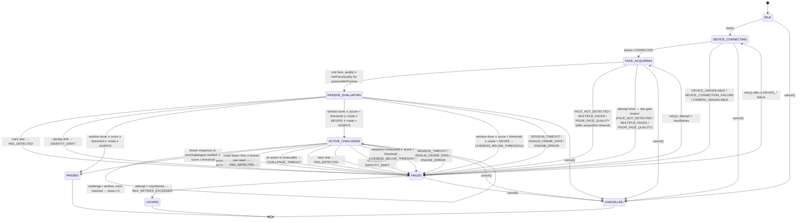
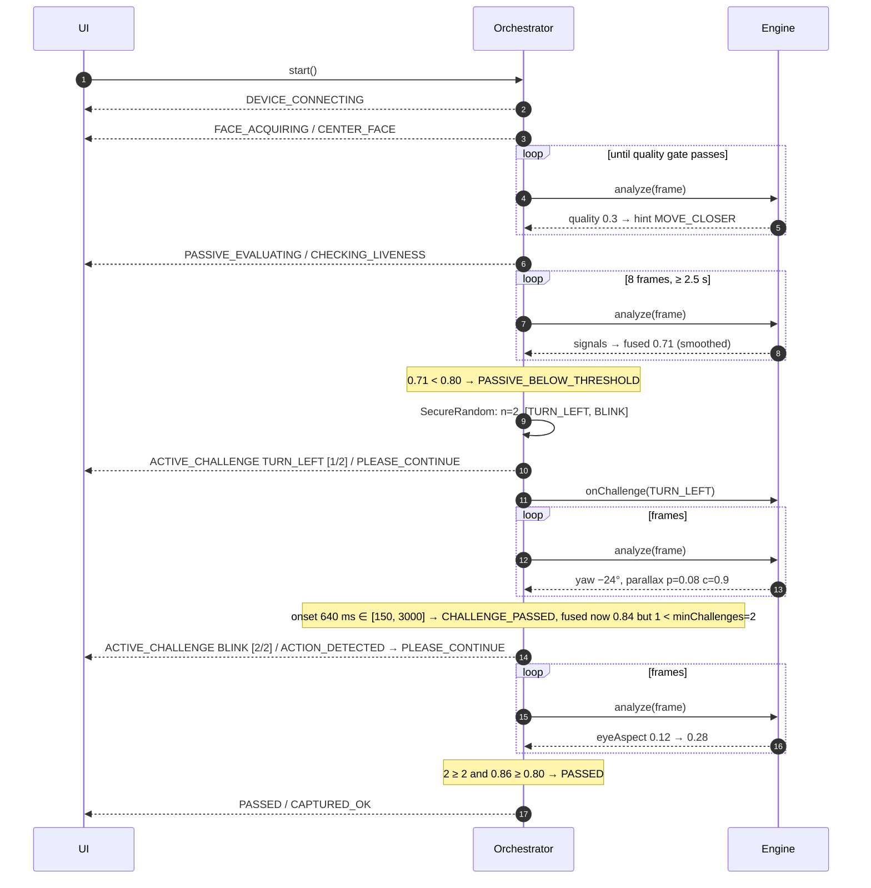

# 04 — Passive-to-active decision flow and dynamic challenges

Covers mandatory task 4 (active liveness) and the "passive-to-active
liveness decision flow" and "dynamic challenge mechanism" deliverables. The
state machine here is the one in `formal/LivenessOrchestrator.tla`, which
TLC checks on every CI run; `liveness-core` implements it.

## 1. State machine



`SessionState` exposes `phase`, `hint`, the current `challenge`, `failure`,
`attempt / maxAttempts`, `progress`, `passiveScore` and
`remainingChallengeMillis`; the UI renders only those.

## 2. Passive window

* Starts when `FACE_ACQUIRING` hands over (quality gate satisfied).
* Ends when both `passiveMinFrames` (default 8) frames have been scored and
  `passiveWindowMillis` (default 2500 ms) have elapsed. Both conditions, so
  a 30 fps device does not decide in 270 ms and a 5 fps device does not
  decide on two frames.
* Every frame updates the smoothed fused score and checks vetoes and drift.
* The user does nothing; the UI shows "Checking face liveness…".

Decision at the end of the window (`PassiveDecide` in the spec):

| `activeMode` | `score ≥ passiveThreshold` | `score < passiveThreshold` |
|---|---|---|
| `NEVER` | `PASSED` | `FAILED(LIVENESS_BELOW_THRESHOLD)` |
| `ON_LOW_CONFIDENCE` (the problem statement's base flow) | `PASSED` | `ACTIVE_CHALLENGE` |
| `ALWAYS` (default for all three workflows) | `ACTIVE_CHALLENGE` | `ACTIVE_CHALLENGE` |

**Why the resident default is `ALWAYS`.** The problem statement's base flow (accept on a passive pass, challenge otherwise) is `ON_LOW_CONFIDENCE` and remains fully supported. The shipped default is `ALWAYS` because the proxy evaluation on real faces ([`docs/testing/proxy-eval/README.md`](../testing/proxy-eval/README.md)) found that simulated prints that pass the CNN texture check score 0.98–0.99, as live as real people: no passive threshold separates them, and passive-only resident capture accepted about 83 % of them. A print cannot answer a challenge. A deployment with a stronger passive engine can set `resident.active.mode=ON_LOW_CONFIDENCE`.


Audit: `PASSIVE_PASSED` or `PASSIVE_BELOW_THRESHOLD` with the score.

## 3. Challenge selection

### 3.1 Inputs

* `policy.challengePool` (default `BLINK, SMILE, TURN_LEFT, TURN_RIGHT,
  OPEN_MOUTH`; `NOD`, `LOOK_UP` and `LOOK_DOWN` are supported but left out of
  the default until the pitch estimate is validated on real faces, see
  `docs/testing/e2e-findings.md`) or `policy.accessibilityPool` (default `BLINK, SMILE, HOLD_STILL`)
  when `SessionContext.assistedCapture` is true.
* `EngineInfo.supportedChallenges`: the pool is intersected with what the
  engine can verify.
* `DeviceCapabilities`: at low frame rates (< 10 fps) `BLINK` is replaced by
  `BLINK_TWICE` because a single blink lasts 100–150 ms and can fall between
  frames.
* `policy.requireDepthRevealingChallenge` (default true): if any
  `ChallengeType.revealsDepth()` member remains in the effective pool, at
  least one is included so S5 has something to measure.
* `minChallenges`, `maxChallenges`.

### 3.2 Algorithm

```
seed      = SecureRandom (system entropy), one instance per session
n         = minChallenges + seed.nextInt(maxChallenges − minChallenges + 1)
pool      = effectivePool (ordered deterministically by enum ordinal, then shuffled with seed)
sequence  = first n of the shuffle, without replacement
if requireDepthRevealing and pool has a depth-revealing type and sequence has none:
    replace a random non-depth element with a random depth-revealing one (seed-driven)
if |pool| < n: n = |pool|  (policy validation already rejects minChallenges > |pool|)
nonce     = SessionContext.nonce (16 random bytes created by the client at open())
audit CHALLENGE_ISSUED(type, index, nonceHex) for each challenge as it is issued
```

Properties:

* The user never selects anything; the client never sees the sequence
  before it is issued.
* Unpredictability comes from `SecureRandom`; the session nonce is logged
  next to the sequence so an auditor can confirm sequences differ across
  sessions and are not a function of time or user id. A chi-square test on
  10,000 draws is a unit test (`UT-CH-003` in the test plan).
* Challenges are issued one at a time; challenge `i+1` is drawn into the
  sequence at session start but only revealed after `i` is verified, so a
  replay attacker who learns the first prompt learns nothing about the
  next.

### 3.3 Action verification

Each `ChallengeType` has a detector over the stream of `FaceObservation`s
(engine-agnostic geometry):

| Challenge | Onset criterion | Completion criterion | Anti-replay |
|---|---|---|---|
| `BLINK` | `eyeAspect` drops below 0.18 from above 0.25 | reopens above 0.25 within 400 ms | first closure must be after `issuedAtNanos + minActionLatencyMillis`; a closure already in progress at issue time is ignored |
| `BLINK_TWICE` | as above | two closures within 1.5 s | as above |
| `SMILE` | `smileScore` rises above 0.6 (or blendshape `mouthSmileLeft/Right` mean > 0.5) | held ≥ 300 ms | baseline `smileScore` at issue must be < 0.4 |
| `OPEN_MOUTH` | `mouthAspect` > 0.5 | held ≥ 300 ms | baseline < 0.25 |
| `RAISE_EYEBROWS` | `browRaiseScore` > 0.5 | held ≥ 300 ms | baseline < 0.3 |
| `TURN_LEFT` / `TURN_RIGHT` | yaw passes ±20° in the requested direction | returns within ±10° | baseline |yaw| < 10°; opposite direction fails the challenge |
| `LOOK_UP` / `LOOK_DOWN` | pitch passes ±12° | returns | baseline |pitch| < 6° |
| `NOD` | pitch excursion > 12° | return then second excursion within 2 s | baseline |pitch| < 6° |
| `HOLD_STILL` | landmark velocity < threshold for 1.5 s | — | used in the accessibility pool; it still exercises S4 (rPPG) and S1–S3 for a longer window |

Verification yields `ChallengeOutcome{result, latencyMillis, durationMillis}`
and `CHALLENGE_PASSED(latencyMs)` / `CHALLENGE_TIMEOUT` audit events.

## 4. Timing window (S6)

```mermaid
gantt
    dateFormat  x
    axisFormat  %L ms
    title One challenge timeline (defaults)
    section Challenge
    prompt shown                 :milestone, m1, 0, 0
    too fast (fail)              :crit, 0, 150
    human window (pass)          :active, 150, 6000
    timeout                      :crit, 6000, 8000
```



* `minActionLatencyMillis` (150 ms): onset before this fails the challenge
  (`ACTIVE_CHALLENGE_FAILED`), because a human reaction to a visual prompt
  takes longer and a replayed or scripted response does not.
* `maxActionLatencyMillis` (3000 ms; lowered from 6000 after end-to-end replay testing, see docs/testing/e2e-findings.md): onset after this is a timeout.
* `challengeTimeoutMillis` (8000 ms): the challenge ends regardless.
* `remainingChallengeMillis` in `SessionState` drives the UI countdown.
* Timers run on `tick()` as well as `feed()`, so a stalled device cannot
  freeze a challenge open.

## 5. Re-evaluation during active verification

Every active-challenge frame is also a passive frame:

1. Flags first: a hard veto or identity drift fails the attempt before the
   action outcome is examined (`PAD_DETECTED` / `IDENTITY_DRIFT`).
2. Then the action detector.
3. Then, if the action completed: the next drawn challenge is issued. When
   the whole drawn sequence (between `minChallenges` and `maxChallenges`
   long) is verified, the session is `PASSED` only if the fused score of
   that frame is at or above `passiveThreshold`; otherwise the attempt fails
   with `LIVENESS_BELOW_THRESHOLD`. (The orchestrator does not stop early
   after `minChallenges`: the challenge selector guarantees enough
   informative, non-spontaneous challenges only over the whole sequence.
   This rule is checked against the TLA+ model by trace replay; see
   `formal/README.md`.)

This is the mandatory "re-evaluate liveness during active verification"
bullet and the reason `maxChallenges` exists: challenges are a means of
collecting evidence (S5, S6), not a substitute for it.

## 6. Retry and lock-out

* `retry()` is allowed while `phase = FAILED ∧ attempt < maxRetries`.
  `attempt` counts attempts started (first attempt is 1); `maxRetries` is
  therefore the total number of attempts. A retry clears the per-attempt
  state (vetoes, drift, window, challenges) and returns to
  `FACE_ACQUIRING`, or to `DEVICE_CONNECTING` after a device failure.
* When `attempt = maxRetries` and the attempt fails, the session steps to
  `LOCKED` with `MAX_RETRIES_EXCEEDED`, hint `MAX_RETRIES_REACHED`, audit
  `MAX_RETRIES_REACHED(onMaxRetries)`.
* What the client does next is `policy.onMaxRetries`:

| Value | Client behaviour |
|---|---|
| `RETRY_ONLY` | Show the max-retry screen; the operator may start a new session later (new session id, full audit). |
| `LOCK_AND_ALERT` | Operator/supervisor auth: lock the auth dialog for `lockoutMillis`, raise an alert audit event, require a different authentication path (password + supervisor). |
| `ASSISTED_CAPTURE_WITH_SUPERVISOR` | Resident capture: a supervisor must authenticate (and pass their own liveness) to attest an assisted capture; the resident's session is re-opened with `assistedCapture = true`, which switches to the accessibility pool and a longer passive window with stricter thresholds. All of it is audited with `SUPERVISOR_OVERRIDE(supervisorId)`. |
| `FALLBACK_TO_EXCEPTION_FLOW` | Resident capture: route to the existing biometric-exception mechanism with a mandatory reason code. |

None of these bypasses liveness silently: each starts a new, audited
session or a documented exception path.

## 7. Accessibility pool

Some residents cannot perform head movements or facial expressions. When
the operator marks assisted capture (`SessionContext.assistedCapture =
true`):

* the effective pool is `policy.accessibilityPool`, which must contain only
  types with `requiresMotorAbility() = false` (policy validation enforces
  it);
* `HOLD_STILL` is allowed, which extends the passive window so S4 (rPPG)
  and S1–S3 accumulate more evidence;
* `passiveThreshold` is raised by `assistedThresholdDelta` (default +0.05)
  because the active evidence is weaker;
* the result is marked `assisted` in audit and in packet metadata so
  downstream quality assurance can sample these records.

This keeps the inclusion promise of a national ID system without creating
an unaudited bypass.

## 8. Session timeline example (resident, ON_LOW_CONFIDENCE, passive below threshold)


