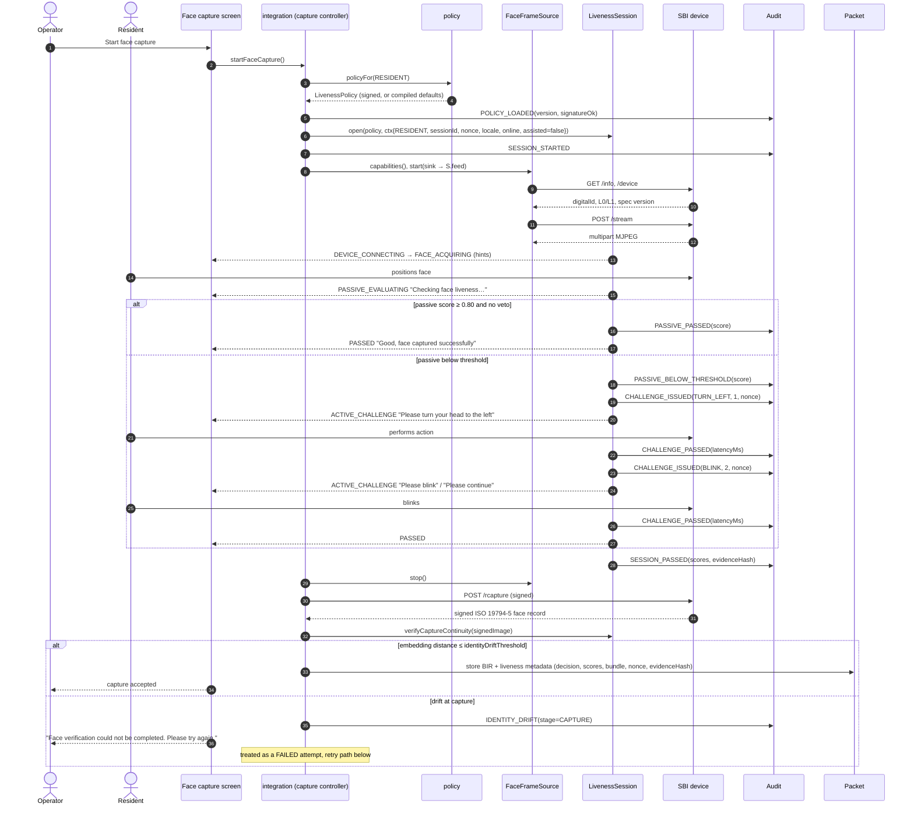
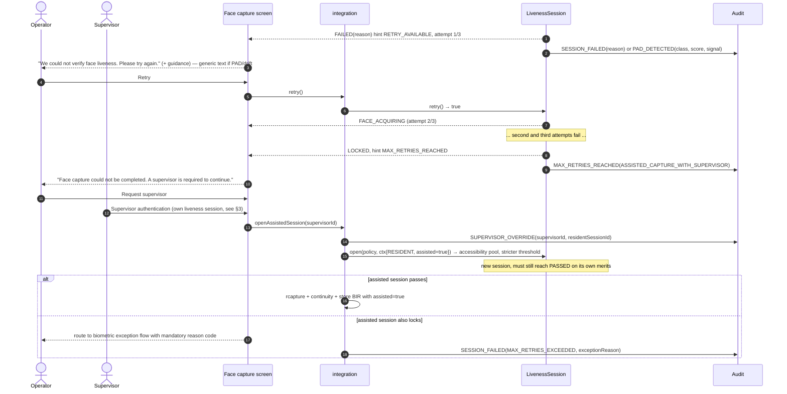
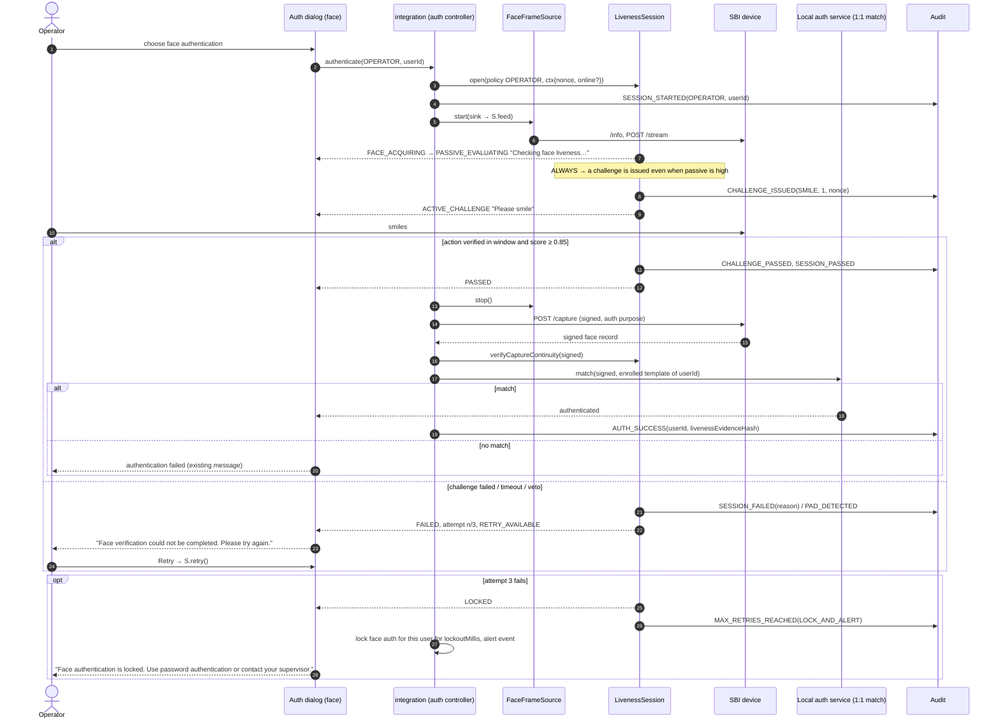
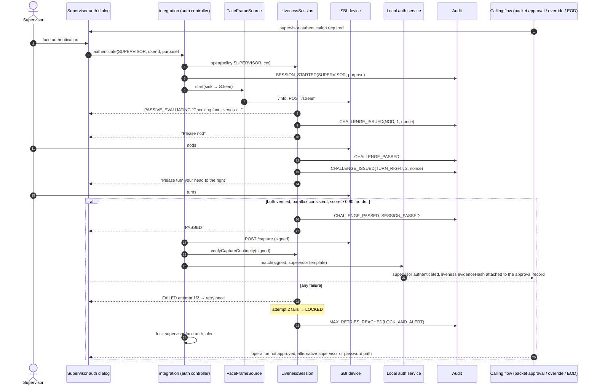

# 05 — Workflow integration flows

Covers mandatory tasks 5, 6 and 7 and the three "integration flow"
deliverables. Each diagram runs from "start capture" through SBI calls, the
liveness session, UI states, audit, to the packet or authentication gate,
and includes the retry and max-retry branches. Class names of the existing
client code are those identified in `docs/recon/`; the glue code lives in
`integration-desktop` and `integration-android` (as designed).

Common legend: `S` = `LivenessSession` (liveness-core), `Src` =
`FaceFrameSource` (adapter), `SBI` = device service, `Aud` = MOSIP audit
manager via `telemetry`.

## 1. Resident face capture

Policy defaults: `passiveThreshold 0.80`, `activeMode ALWAYS` (see 04 §2 for why; `ON_LOW_CONFIDENCE` is supported),
`minChallenges 2`, `maxChallenges 3`, `maxRetries 3`,
`onMaxRetries ASSISTED_CAPTURE_WITH_SUPERVISOR`.

Failure, retry and max-retry branch (same participants):

## 2. Operator authentication

Policy defaults: `passiveThreshold 0.85`, `activeMode ALWAYS`,
`minChallenges 1`, `maxChallenges 2`, `maxRetries 3`,
`onMaxRetries LOCK_AND_ALERT`.

The match never runs unless the session is `PASSED` and the signed capture
passes continuity. Offline: identical, because the policy, engine and
models are local; only the audit upload is deferred.

## 3. Supervisor authentication

Policy defaults: `passiveThreshold 0.90`, `activeMode ALWAYS`,
`minChallenges 2`, `maxChallenges 3`, `maxRetries 2`,
`onMaxRetries LOCK_AND_ALERT`.

Why stricter: a supervisor's authentication authorises overrides, including
assisted capture after a resident lock-out. Two challenges, a higher
threshold and only two attempts raise the cost of a presentation attack at
the point where it would do the most damage.

## 4. Where the gates are

| Workflow | Gate | Condition to pass the gate |
|---|---|---|
| Resident | `rcapture` invocation | `session.state().phase == PASSED` |
| Resident | BIR stored in packet | continuity check on the signed image passes |
| Operator | `capture` + 1:1 match | `PASSED` and continuity |
| Supervisor | `capture` + 1:1 match | `PASSED` and continuity |
| All | policy `enabled = false` | the integration skips session creation, stores `livenessSkipped = POLICY_DISABLED` in metadata and emits `POLICY_LOADED(enabled=false)` so the omission is visible in audit |

## 5. Consistency across workflows and platforms

The three flows differ only in the `Workflow` passed to `open()`, the policy
it selects, and which signed SBI call follows `PASSED`. Everything between
`start()` and the terminal state is the same code path on desktop and
Android, which is how the "consistent behaviour" requirement is met rather
than merely intended.
