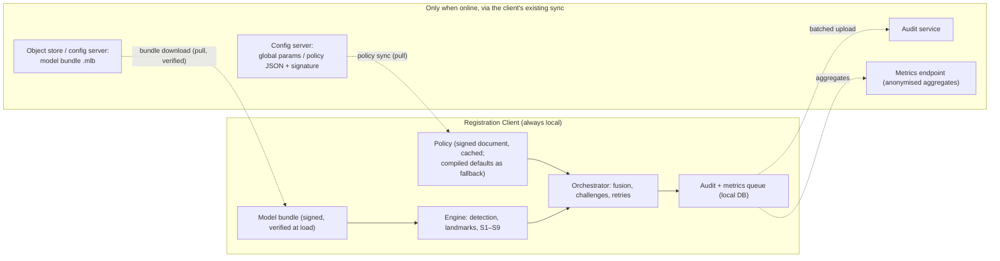

# 06 — Online and offline architecture

The problem statement requires that "network availability does not
determine whether liveness security is enforced". The design makes that a
structural property rather than a configuration: nothing on the hot path
has a network dependency, and there is no code path that behaves
differently when `SessionContext.online` is false except the UI indicator
and the audit flush timing.

## 1. What runs where

| Activity | Needs network | Mechanism | Offline behaviour |
|---|---|---|---|
| Passive liveness, PAD, fusion | No | in-process | identical |
| Challenge generation and verification | No | `SecureRandom` + orchestrator | identical |
| Policy read | No | cached signed document; compiled defaults if none | identical |
| Policy update | Yes | existing global-param sync; signature verified before activation | last good policy stays in force |
| Model bundle update | Yes (online channel) or USB (offline channel) | `model-bundle` verifier for both | last good bundle stays in force; rollback on failed self-test |
| Audit events | No to record, yes to upload | local queue, flushed by the client's sync | queued |
| Anonymised metrics | No to compute, yes to upload | aggregated locally per centre | queued |
| Diagnostic snapshot | No | local file (scores only) | identical |

## 2. Proof, not promise

* `IT-OFF-001` in the test plan runs the full scenario suite inside a
  network namespace with no interfaces up (desktop) and with airplane mode
  on an emulator (Android). Any attempt to open a socket from the liveness
  modules fails the test; the suite must pass with identical outcomes to
  the online run.
* The modules `liveness-api`, `device-api`, `liveness-core`, `policy`,
  `telemetry`, `liveness-engine-onnx` and `model-bundle` have no network
  client on their classpath; `device-sbi-stream` talks only to loopback.
  An ArchUnit rule (`UT-ARCH-001`) enforces that `java.net.http` and
  `java.net.Socket` are referenced only from `device-sbi-stream` and
  `device-mock`.

## 3. Policy freshness

Policies carry a `policyVersion` and an `issuedAt`. The client records which
version each session used (`LivenessResult.policyVersion`). There is no
expiry: an old policy is enforced until a newer signed one arrives, because
an expiring policy would turn a long outage into a liveness outage. A
centre that has been offline for a long time is visible to the server
through the policy version in uploaded audit records.

## 4. Model freshness

Same principle: a bundle is valid until replaced. A new bundle is activated
only after signature and hash verification and a passing self-test
(`LivenessEngine.selfTest()`); otherwise the previous bundle remains active
and `MODEL_BUNDLE_REJECTED(reason)` is queued for audit. Offline import
through a supervisor-only screen takes a `.mlb` from a local path or USB
and goes through the identical verifier (`11-model-lifecycle.md`).

## 5. Audit and metrics while offline

* Events are written to the client's local audit table in the same
  transaction as the capture or authentication outcome, so a packet never
  exists without its liveness evidence.
* The queue is bounded only by disk; events are small (no frames, no
  embeddings).
* Metrics are pre-aggregated per centre and per day (counts, means,
  histograms) so the upload size does not grow with volume and no
  per-resident record is ever created.

## 6. UI

An unobtrusive indicator on the liveness overlay reads "Online" or
"Offline". It is informational; no control is disabled or enabled by it.
The indicator exists so an operator can explain to a resident why a sync is
pending, not because the capture behaves differently.

## 7. Time

Timeouts and the S6 timing window use the monotonic clock
(`System.nanoTime()`, `FaceFrame.timestampNanos`). Wall-clock time appears
only in audit timestamps; an offline client with a wrong clock still
enforces liveness correctly.
