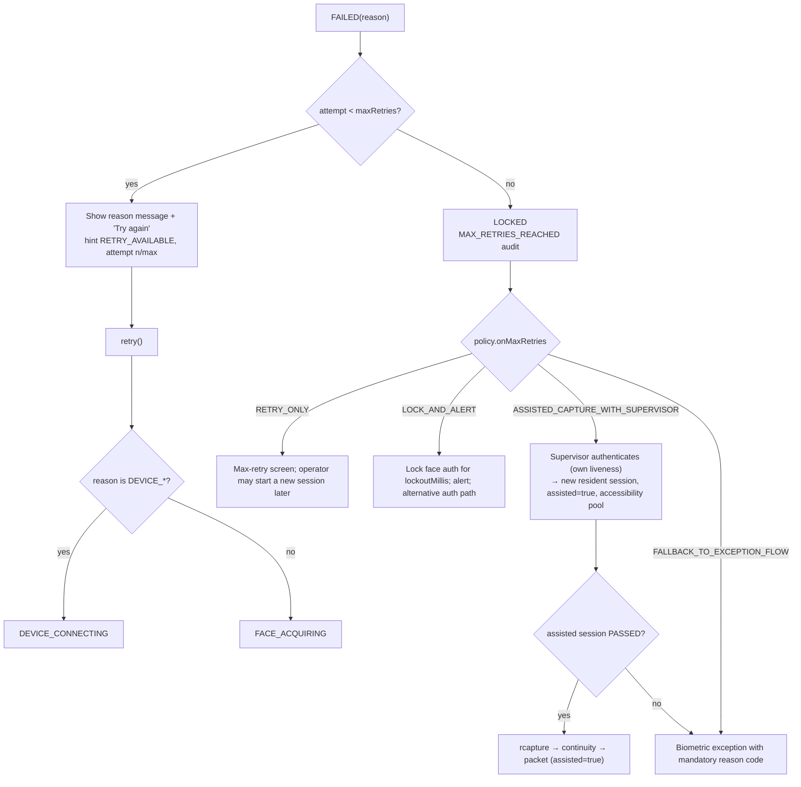

# 08 — Error handling and recovery

Covers mandatory task 9. Every error case named in the problem statement
maps to one `FailureReason`, one phase transition, one `SessionState.Hint`,
one user-facing message (from the UX spec, `12-ux-spec.md`), one audit event
and one recovery path. The two security vetoes and the remaining
`FailureReason` values are included so the table is the complete catalogue.

## 1. Principles

* **Fail closed.** Every error ends the attempt in `FAILED` (or the session
  in `LOCKED`); there is no error that results in `PASSED`.
* **Generic to the user, precise in audit.** `FailureReason.isSecuritySensitive()`
  (`PAD_DETECTED`, `IDENTITY_DRIFT`) selects the generic message. All other
  reasons get actionable guidance.
* **Retries are a budget, not a loop.** Every `retry()` consumes an attempt
  regardless of the reason, so the state machine is bounded
  (`AttemptsBounded`, `EventuallyTerminal` in `formal/`). Device
  reconnection inside an attempt does not consume the budget; only an
  attempt-ending failure does.
* **Recovery is a documented path, never a bypass.** Where recovery starts
  a new session, the new session must pass on its own.

## 2. The matrix

Columns: PS = problem-statement case number; Phase = where the failure is
raised → resulting phase; Hint = `SessionState.Hint`; Message = exact UI
copy (desktop and Android share i18n keys; key names in `12-ux-spec.md`).

| PS | Case | `FailureReason` | Raised in → phase | Hint | UI message | Audit event | Recovery |
|---|---|---|---|---|---|---|---|
| 1 | Device unavailable | `DEVICE_UNAVAILABLE` | `DEVICE_CONNECTING` → `FAILED` | `DEVICE_DISCONNECTED` | "Face capture device not found. Check that the device is connected and switched on, then try again." | `DEVICE_FAULT(UNAVAILABLE, adapterId)` | Device-error screen with "Retry" (→ `DEVICE_CONNECTING`) and "Diagnostics" when enabled. Operator fixes hardware; retry consumes an attempt; after lock-out a new session may be started once the device is healthy. |
| 2 | Device connection failure | `DEVICE_CONNECTION_FAILURE` | `DEVICE_CONNECTING` or after reconnect attempts exhausted mid-stream → `FAILED` | `DEVICE_RECONNECTING` while retrying, then `DEVICE_DISCONNECTED` | During: "Reconnecting to device…". After: "Lost connection to the face capture device. Check the cable and try again." | `DEVICE_FAULT(CONNECTION, reason, reconnectAttempts)` | Automatic reconnect with backoff (`02-frame-streaming.md`); session pauses; if the device returns within the challenge timeout the attempt continues; else as case 1. |
| 3 | Camera unavailable | `CAMERA_UNAVAILABLE` | `DEVICE_CONNECTING` → `FAILED` | `DEVICE_DISCONNECTED` | "The camera is not available. Close other applications that may be using it and try again." | `DEVICE_FAULT(CAMERA, reason)` | As case 1. Android: also offer the OS permission screen when the cause is a denied permission. |
| 4 | Face not detected | `FACE_NOT_DETECTED` | `FACE_ACQUIRING` after `acquisitionTimeoutMillis` → `FAILED` | `LOOK_AT_CAMERA` during acquisition | During: "Look directly at the camera." After: "We could not verify face liveness. Please try again." + guidance list | `SESSION_FAILED(FACE_NOT_DETECTED, acquisitionMillis)` | "Try again" → `FACE_ACQUIRING`. Guidance: look at the camera, ensure the face is clearly visible, keep the face within the capture area. |
| 5 | Multiple faces detected | `MULTIPLE_FACES` | `FACE_ACQUIRING` (sustained for 2 s) → `FAILED`; during `PASSIVE`/`ACTIVE` a second face pauses scoring and shows the hint, failing only if sustained | `ONLY_ONE_FACE` | "Only one face should be visible. Ask others to step out of the camera view." | `SESSION_FAILED(MULTIPLE_FACES)` | "Try again". Operator clears the background. |
| 6 | Poor face quality | `POOR_FACE_QUALITY` | `FACE_ACQUIRING` after `acquisitionTimeoutMillis` → `FAILED` | the dominant component: `MOVE_CLOSER`, `MOVE_BACK`, `CENTER_FACE`, `IMPROVE_LIGHTING`, `HOLD_STILL` | During: the matching hint ("Move closer", "Move back", "Centre your face", "Improve lighting", "Hold still"). After: liveness-failure message + guidance | `SESSION_FAILED(POOR_FACE_QUALITY, qualityComponents)` | "Try again". The hint shown during acquisition is the actionable part. |
| 7 | Liveness quality below threshold | `LIVENESS_BELOW_THRESHOLD` | `PASSIVE_EVALUATING` with `activeMode = NEVER`, or `ACTIVE_CHALLENGE` after the sequence is exhausted → `FAILED` | `TRY_AGAIN` / `RETRY_AVAILABLE` | "We could not verify face liveness. Please try again." + guidance list | `SESSION_FAILED(LIVENESS_BELOW_THRESHOLD, fusedScore, signalScores)` | "Try again" → `FACE_ACQUIRING`. With `ON_LOW_CONFIDENCE`/`ALWAYS` this case is reached only after challenges; the guidance "Follow the prompted action" is included. |
| 8 | PAD failure | `PAD_DETECTED` | `PASSIVE_EVALUATING` or `ACTIVE_CHALLENGE` (hard veto) → `FAILED` | `TRY_AGAIN` | **Generic:** "Face verification could not be completed. Please try again." No guidance list, no attack class. | `PAD_DETECTED(attackClass, fusedScore, vetoSignal, signalScores)` and `SESSION_FAILED(PAD_DETECTED)` | "Try again" consumes an attempt. Detail only in audit and in diagnostic mode (supervisor-gated). Repeated PAD across attempts is visible to the supervisor through the audit viewer and the per-centre PAD-rate metric. |
| 9 | Active challenge failure | `ACTIVE_CHALLENGE_FAILED` | `ACTIVE_CHALLENGE` (wrong action, opposite direction, onset before prompt, onset faster than `minActionLatencyMillis`) → `FAILED` | `TRY_AGAIN` | "We could not verify face liveness. Please try again." + "Follow the prompted action." | `SESSION_FAILED(ACTIVE_CHALLENGE_FAILED, challengeType, index, latencyMs)` | "Try again" → new attempt with a freshly drawn sequence (never the same sequence). |
| 10 | Challenge timeout | `CHALLENGE_TIMEOUT` | `ACTIVE_CHALLENGE` after `challengeTimeoutMillis` → `FAILED` | `TRY_AGAIN` | "We could not verify face liveness. Please try again." + "Follow the prompted action." | `CHALLENGE_TIMEOUT(challengeType, index)` and `SESSION_FAILED(CHALLENGE_TIMEOUT)` | "Try again". If the resident cannot perform motor challenges, the operator marks assisted capture at the next attempt (accessibility pool). |
| 11 | Maximum retries exceeded | the last attempt's reason is kept (`LOCKED` is the signal; `MAX_RETRIES_EXCEEDED` names the case in audit) | `FAILED` with `attempt = maxRetries` → `LOCKED` | `MAX_RETRIES_REACHED` | Resident: "Face capture could not be completed. A supervisor is required to continue." Operator/supervisor: "Face authentication is locked. Use another authentication method or contact your supervisor." | `MAX_RETRIES_REACHED(onMaxRetries, attemptsUsed, lastReason)` | Per `onMaxRetries` (`04-passive-to-active-flow.md` §6): assisted capture with supervisor attestation, lock and alert, or exception flow. Each path is a new audited session or a documented exception record. |
| 12 | Invalid / incomplete frame data | `INVALID_FRAME_DATA` | `PASSIVE_EVALUATING` or `ACTIVE_CHALLENGE` after N consecutive undecodable frames (default 10) → `FAILED`; isolated bad frames are skipped and counted | `DEVICE_RECONNECTING` while skipping | After: "The face capture device sent unreadable images. Check the device and try again." | `DEVICE_FAULT(INVALID_FRAME, count, adapterId)` and `SESSION_FAILED(INVALID_FRAME_DATA)` | "Try again" → `DEVICE_CONNECTING` (the adapter restarts the stream). Diagnostics shows the drop and corruption counters. |
| 13 | Liveness engine error | `ENGINE_ERROR` | any phase where `analyze()` throws or exceeds its time budget repeatedly → `FAILED` | `TRY_AGAIN` | "Face verification is temporarily unavailable. Please try again or contact support." | `SESSION_FAILED(ENGINE_ERROR, exceptionClass, engineId, bundleVersion)` | "Try again". If the engine fails its self-test at start-up the client refuses to open sessions and shows the device-error screen with a support code; the integration does **not** fall back to capture without liveness. |
| — | Identity drift (security veto) | `IDENTITY_DRIFT` | `PASSIVE_EVALUATING`, `ACTIVE_CHALLENGE`, or at the signed-capture continuity check → `FAILED` | `TRY_AGAIN` | **Generic:** "Face verification could not be completed. Please try again." | `IDENTITY_DRIFT(stage, cosineDistance)` and `SESSION_FAILED(IDENTITY_DRIFT)` | "Try again" consumes an attempt. Detail only in audit/diagnostics. |
| — | Session timeout | `SESSION_TIMEOUT` | `FACE_ACQUIRING`, `PASSIVE_EVALUATING`, `ACTIVE_CHALLENGE` after `sessionTimeoutMillis` → `FAILED` | `TRY_AGAIN` | "Face verification took too long. Please try again." | `SESSION_FAILED(SESSION_TIMEOUT, phaseAtTimeout)` | "Try again". |
| — | Cancelled | `CANCELLED` | any non-terminal → `CANCELLED` | `NONE` | none (the user or operator cancelled) | `SESSION_FAILED(CANCELLED, phaseAtCancel)` | Return to the calling screen. A new session may be started. |
| — | Policy disabled | `POLICY_DISABLED` | no session is opened | — | none; the capture screen shows "Liveness check: disabled by policy" in the status strip so the omission is visible | `POLICY_LOADED(version, enabled=false)` | Administrative: only a signed policy can disable liveness. |

## 3. Message rules

* The liveness-failure guidance list is the problem statement's: "Look
  directly at the camera.", "Ensure your face is clearly visible.",
  "Improve lighting.", "Keep your face within the capture area.", "Follow
  the prompted action." The UI shows the subset relevant to the failing
  component (for example, "Follow the prompted action." only after a
  challenge failure) and never more than three items at once.
* The PAD and identity-drift messages are identical and contain no detail.
  They are the only messages that are deliberately not actionable; the
  retry affordance is the action.
* Device messages name the device, not the protocol. "SBI", "MJPEG",
  "boundary" never appear in user copy; they appear in diagnostics.

## 4. Recovery flow

## 5. What the engine and adapters must do for this to work

* Adapters: never throw from `onFrame`; report faults through
  `DeviceHealth` and `onEnd`; use `DeviceException.Kind` so the
  orchestrator can map `UNAVAILABLE → DEVICE_UNAVAILABLE`,
  `CONNECTION_FAILED → DEVICE_CONNECTION_FAILURE`, `CAMERA_UNAVAILABLE →
  CAMERA_UNAVAILABLE`, `PROTOCOL_ERROR → DEVICE_UNAVAILABLE`,
  `INVALID_FRAME → INVALID_FRAME_DATA`.
* Engines: return `FaceQuality.noFace()` rather than throwing when there is
  no face; throw only for genuine faults (model missing, native failure),
  which the orchestrator maps to `ENGINE_ERROR`; keep `processingNanos`
  honest so the time-budget check works.
* Integration: call `tick()` on a timer so timeouts fire without frames;
  render `hint` and `attempt/maxAttempts` on every state change; map
  `failure` to the message table above through i18n keys.
