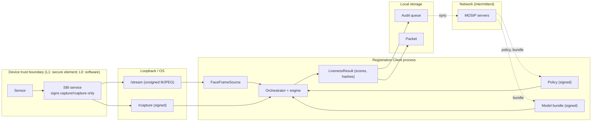

# 09 — Security and privacy

Covers the "security and privacy considerations" deliverable. Section 2 is
a STRIDE threat model over the frame path; section 4 is a DPIA-style
summary. Statements about modules not yet in the repository are *as
designed*.

## 1. Assets and trust boundaries

Assets, by sensitivity:

1. The liveness decision and its binding to the signed capture (integrity
   of the identity register).
2. Face frames and embeddings (biometric personal data).
3. Policy and model bundle (integrity of the control).
4. Audit records (non-repudiation).
5. The challenge sequence and nonce (unpredictability).

## 2. STRIDE over the frame path

| Threat | Where | Attacker capability | Impact | Control | Residual risk |
|---|---|---|---|---|---|
| **Spoofing** — presentation attack at the sensor | sensor | Print, screen, replay, mask, deepfake on a screen | False accept | S1–S8 fusion, hard vetoes, active challenges with S5/S6, per-workflow thresholds | Residual APCER as measured in the evaluation report; high-quality 3-D masks and injected real-time deepfakes are partially covered. |
| **Spoofing** — different person at capture than at liveness | between `/stream` and `/rcapture` | Accomplice performs the challenges, victim photo presented to the signed capture; or a virtual-camera switch | False accept of a non-live face | S7 identity continuity within the session and at the capture boundary (`02-frame-streaming.md` §5) | An attacker controlling both the stream and the signed capture at device level (L0 software devices). Addressed by L1 hardware and the signed-preview proposal. |
| **Spoofing** — injection (virtual camera, hooked driver, replayed USB stream) | OS video stack / loopback | Install software on the client machine | Attack never touches the sensor; PAD texture signals may be fooled by a high-quality live recording | Injection heuristics (`03-liveness-and-pad.md`), S6 timing (recordings cannot answer random prompts), S4 rPPG against synthesised video, signed-frame verification when available | A real-time deepfake driven by a live accomplice answering prompts: S4 and artefact detection partially; definitive fix is a signed preview from an L1 device. |
| **Tampering** — policy loosened in local properties | config files | Write access to the client's config directory | Liveness disabled or thresholds lowered | Signed policy document is the floor; flattened properties may only tighten; verification failure falls back to compiled defaults, never to disabled; audited (`07-configuration.md`) | A compromised signing key. Keymanager rotation procedures apply. |
| **Tampering** — model bundle replaced | bundle directory | Write access | Engine that passes everything | Signature over the manifest, SHA-256 per model file, self-test with packaged live/attack frames, rejection audited (`11-model-lifecycle.md`) | Same key-compromise caveat. |
| **Tampering** — `LivenessResult` or audit record altered after the fact | local DB, packet | Write access to local storage | Non-repudiation lost | `evidenceHash` = SHA-256 over the canonical decision record is recorded in both the packet metadata and the audit event; the packet itself is signed by the existing client machinery; mismatch is detectable server-side | Alteration of both copies plus the packet signature: requires the client's signing key. |
| **Tampering** — frames altered in transit on loopback | loopback HTTP | Local process with raw socket access | Spoof after the sensor | Out of scope for L0 (unsigned stream); signed-preview extension for L1 | As stated. |
| **Repudiation** — "I never approved that override" | supervisor override | Supervisor denies attestation | Accountability | `SUPERVISOR_OVERRIDE(supervisorId, residentSessionId)` emitted only after the supervisor's own `PASSED` session, with both `evidenceHash`es | — |
| **Repudiation** — "the system never challenged me" | challenge log | Operator disputes a lock-out | — | Every `CHALLENGE_ISSUED` carries the session nonce and index; `ChallengeOutcome` carries latency and duration | — |
| **Information disclosure** — frames or embeddings leak to disk, logs or network | engine, telemetry, diagnostics | Log scraping, disk forensics | Biometric data breach | Frames live only in the adapter ring buffer and the engine's working memory; `FaceFrame` buffers are read-only views and dropped after `analyze()`; nothing derived from pixels is logged above TRACE; diagnostics snapshot contains scores only unless `diagnostics.mode = LAB` with explicit consent; ArchUnit test forbids file and network APIs in engine and core | Heap dumps and swap. Mitigated by the client's existing device hardening. |
| **Information disclosure** — attack detail shown to the attacker | UI | Observe the screen | Attacker learns which signal caught them and tunes the next attempt | `FailureReason.isSecuritySensitive()` forces the generic message; attack class and veto signal exist only in audit and supervisor-gated diagnostics | A supervisor account used by an attacker. |
| **Information disclosure** — challenge sequence predicted | challenge selection | Observe many sessions | Pre-recorded responses | `SecureRandom` per session; sequence revealed one challenge at a time; nonce logged so unpredictability is auditable; chi-square test in CI | — |
| **Denial of service** — repeated PAD attempts to lock out an operator | auth | Physical presence | Operator cannot authenticate | `LOCK_AND_ALERT` is per user and time-bounded; alternative authentication path; alert audit | Intentional trade-off: availability of an alternative path versus brute-force. |
| **Denial of service** — stalled or flooding device | stream | Faulty or malicious device | Client hangs or runs out of memory | Ring buffer with drop-oldest, stall watchdog, reconnect limits, session timeout driven by `tick()` | — |
| **Elevation of privilege** — bypass through assisted capture | assisted path | Operator alone | Capture without liveness | Assisted capture requires a supervisor session that itself passed liveness; the resident's assisted session still runs liveness with a stricter passive threshold; both audited | Collusion between operator and supervisor, visible through the override-rate metric. |
| **Elevation of privilege** — `enabled = false` | config | Config write | Liveness off | Honoured only from the signed document; audited | Key compromise. |

## 3. Attacker model summary

| Attacker | Capabilities assumed | Covered |
|---|---|---|
| Opportunistic resident | Printed photo, phone screen, someone else's video | Yes, primary target |
| Prepared impostor | High-quality print, cut-out, tablet replay, paper/cloth mask, choosing lighting | Yes |
| Resourced impostor | Silicone mask, injected deepfake, virtual camera on the client | Partially; measured and reported honestly (`10-iso-30107-alignment.md`) |
| Insider operator | Local config edits, repeated attempts, assisted-capture misuse | Yes (signing, retry budget, supervisor attestation, metrics) |
| Insider with client signing keys | Everything | No; outside the scope of a client-side control |

## 3a. Injection attacks: layered defences as built

Injection attacks bypass the sensor: a virtual camera, a hooked capture API, a USB capture dongle replaying a
screen, or a proxy on the SBI port. The table maps each to what is implemented and how it is tested.

| Injection route | Defence (implemented) | Tested by | Gap |
|---|---|---|---|
| Virtual camera with a known name (OBS, ManyCam, v4l2loopback, ...) | `InjectionSignal` name list; hard veto when the source is the system camera | `ParallaxInjectionQualityTest`; Attack Lab "Injected stream" | Windows enumeration needs host-supplied names |
| Virtual camera renamed to look real (`v4l2loopback card_label="Integrated Camera"`) | Linux sysfs check: driver `v4l2loopback`, or no USB/PCI ancestor, marks `[no physical bus]` | fake sysfs in `ParallaxInjectionQualityTest` | Not tried with a loaded kernel module (needs root) |
| HDMI-to-USB capture dongle replaying a laptop screen | USB vendor:product check against known capture cards, marked `[usb capture card vvvv:pppp]` | fake sysfs test | List is not exhaustive; an unknown UVC grabber passes this check (S1/S2 and challenges remain) |
| Proxy or impostor service on the SBI port, frames replaced or replayed in transit | Signed preview stream (`02-frame-streaming.md` §6): device-key-signed session, per-frame HMAC, increasing sequence; unsigned frame from a signing device ends the session as `INJECTION` | `SignedPreviewTest`, `FrameSourceBridgeTest` | Requires devices implementing the extension (none exist yet; the mock does) |
| Pre-recorded or deepfaked video answering nothing | Random challenges, unprompted-action check, 3 s latency, S6 timing | `InteractiveChallengeTest` (replay 0/30 with three challenges) | A live accomplice driving a real-time deepfake |
| Tampered Android capture path (hooked CameraX, rooted device) | Not implemented: Play Integrity / key attestation | — | Needs Google Play services and a server-side verdict check |

## 4. Privacy: DPIA-style summary

**Purpose.** Establish that a live person is present at face capture and
authentication; detect presentation attacks. Lawful basis is the same as
the registration itself.

**Data processed.**

| Data | Where | Retention | Persisted? |
|---|---|---|---|
| Face frames from the stream | adapter ring buffer, engine working memory | until the next frame | **No** |
| Face geometry (`FaceObservation`) | orchestrator, per frame | until the next frame; summary statistics per challenge | No |
| Identity embeddings | orchestrator, session anchor | until `close()` | **No** (in memory; `LivenessResult.anchorEmbedding` is cleared on close) |
| Per-signal scores, fused score, decision, challenge log, timings | `LivenessResult` | session lifetime, then audit | Yes: scores and decisions only |
| Session nonce, `evidenceHash`, engine/bundle/policy versions | `LivenessResult` | — | Yes |
| Diagnostic snapshot | diagnostics (supervisor) | until deleted | Scores only; raw frames only in `LAB` mode with a consent toggle, for evaluation sites |
| Anonymised metrics | telemetry | aggregated per centre per day | Yes, no per-person fields |

**Data minimisation.** The engine interface is designed so the orchestrator
never needs pixels: `FrameAnalysis` carries numbers. The adapter is the
only component that holds image bytes, and it holds at most
`maxQueuedFrames`.

**No new biometric template.** The embedding is a same-session consistency
check and is destroyed at session end. It is never compared across
sessions or persons and never leaves the process.

**Transparency.** The capture screen states that liveness is being
checked. Challenge prompts are plain language. The generic PAD message is
a deliberate exception justified by the security purpose; the detail is
available to the data subject through the audit process of the registering
authority.

**Inclusion.** The accessibility pool and assisted capture exist so that
residents who cannot perform motor challenges are not excluded; these
records are flagged for quality assurance rather than silently treated as
ordinary captures. BPCER is reported per demographic slice of the
evaluation corpus so that systematic false rejects are visible.

**Corpus ethics.** Training and evaluation data are collected from
consenting adults under a written consent form that covers attack
instruments made from their images; public research-only datasets are
never used for shipped weights. Procedure in `docs/corpus-ethics.md`
(to be written with the first corpus collection).

**Risks and mitigations.** The highest residual privacy risk is a developer
enabling frame logging for debugging and shipping it. Mitigation: the
ArchUnit rule, code review checklist item in the PR template, and the
`diagnostics.mode = LAB` gate that is off by default and audited.

## 5. Audit tamper-evidence

`evidenceHash = SHA-256(canonicalJson(record))` where `record` contains
`sessionId`, `workflow`, `decision`, `failure`, `fusedLivenessScore`,
`signalScores`, `vetoSignal`, `attackClass`, the challenge log (type, index,
result, latency, duration), `attemptsUsed`, timings, `engineId`,
`modelBundleVersion`, `policyVersion`, `nonceHex`. The hash is:

* stored in the audit event `SESSION_PASSED` / `SESSION_FAILED`;
* stored in the packet metadata (resident) or the authentication record
  (operator, supervisor);
* reproducible from the audit record's fields, so a server-side job can
  verify that the audit record and the packet refer to the same decision
  and that neither has been edited.

It does not include frames or embeddings, so it cannot be used to recover
biometric data.
