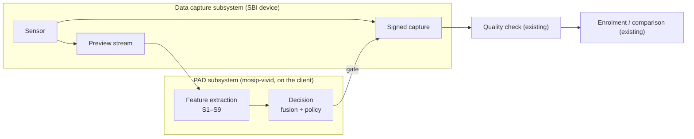

# 10 — ISO/IEC 30107 alignment

Covers the "evaluate the selected solution against applicable ISO/IEC
30107 requirements" task and the "ISO/IEC 30107 alignment considerations"
deliverable. ISO/IEC 30107-1:2023 defines the framework and vocabulary;
30107-3:2023 defines testing and reporting. This document maps the
mosip-vivid design onto both and states, without embellishment, what has
and has not been evaluated.

## 1. Terminology mapping (30107-1)

| ISO/IEC 30107-1 term | Meaning | In mosip-vivid |
|---|---|---|
| Presentation attack (PA) | Presentation to the biometric capture subsystem with the goal of interfering with its operation | Anything the engine's attack classes name: `PRINT`, `SCREEN_REPLAY`, `VIDEO_REPLAY`, `MASK`, `DEEPFAKE`; `INJECTION` is tracked but is not a presentation attack in the ISO sense (it bypasses the capture subsystem) |
| Presentation attack instrument (PAI) | The object used in a PA | A specific print, screen, mask or replayed video |
| PAI species | A class of PAIs created with the same method and materials | The rows of the evaluation report: A4 matte print, glossy print, cut-out print, phone screen photo, tablet screen video, paper mask, … |
| Bona fide presentation | Interaction of the capture subject with the capture subsystem in the fashion intended by the policy | A live resident, operator or supervisor following the on-screen guidance |
| Impostor / concealer | Attacker goal: be recognised as someone else / not be recognised | Both apply in registration: an impostor enrols under a false identity; a concealer attempts to avoid deduplication. PAD treats both identically. |
| Attack presentation | A presentation that is a PA | A session in the testkit labelled with a PAI species |
| PAD subsystem | The subsystem that detects PAs | `liveness-core` + the engine, as placed in §2 |
| PAD score | Output of the PAD subsystem | `fusedLivenessScore` (and per-signal `attackProbability`) |
| PAD decision | Binary outcome | `LivenessResult.decision` ∈ `{LIVE, NOT_LIVE, ATTACK}` (`ERROR` and `CANCELLED` are non-decisions and excluded from rates) |
| Liveness detection | Measurement and analysis of anatomical characteristics or involuntary/voluntary reactions to determine whether a sample is from a live subject | Passive signals (anatomical: S1–S4, S8), involuntary (S4 rPPG), voluntary reactions (active challenges, S5, S6) |
| Artefact | An artificial object or representation presenting a copy of biometric characteristics | Print, screen, mask, deepfake |
| Human-based PA | Attacks using a human (coerced, altered, lifeless, non-conformant) | Out of scope for automated PAD; the operator-present process and supervisor controls address coercion; non-conformant presentations are caught by the quality gate (S9) |

## 2. Placement of the PAD subsystem

30107-1 locates PAD at the data capture subsystem and/or the signal
processing subsystem. mosip-vivid is placed at the **signal processing
stage on the client**, consuming the capture device's raw preview and
producing a decision that gates the capture subsystem's signed output
(`rcapture`/`capture`).

Consequences:

* PAD is independent of the comparison subsystem; it works for enrolment
  (no reference template) as well as for verification.
* A device with its own PAD (some L1 devices) is complementary: its
  decision could be surfaced as an additional `SignalScore` by the adapter
  (`Signals.DEPTH` / `IR` or a vendor id), fused like any other.
* Because the preview is unsigned, the PAD subsystem's inputs are not
  authenticated at L0; §5 of `02-frame-streaming.md` and the signed-preview
  proposal address this. This is a 30107-1 "attack on the channel between
  capture and signal processing" rather than a PA, and is reported as such.

## 3. Metrics (30107-3)

Definitions used by `testkit`, following 30107-3 §3 and clause 9:

| Metric | Definition | Computation in `testkit` |
|---|---|---|
| **APCER** (attack presentation classification error rate), per PAI species | Proportion of attack presentations using the same PAI species incorrectly classified as bona fide | For species `s`: `APCER_s = (1/N_s) Σ_i (1 − Res_i)` where `Res_i = 1` if presentation `i` is classified as an attack (decision ≠ `LIVE`), `N_s` the number of attack presentations of species `s`. Reported per species; the **maximum over species** is the headline figure, as 30107-3 recommends ("APCER of the worst-case PAI species"). |
| **BPCER** (bona fide presentation classification error rate) | Proportion of bona fide presentations incorrectly classified as attacks | `BPCER = (1/N_BF) Σ_j Res_j` over bona fide presentations, where `Res_j = 1` if classified as an attack (decision ≠ `LIVE`, excluding `ERROR`/`CANCELLED`). Reported overall and per demographic slice and per capture device. |
| **ACER** | `(APCER_max + BPCER) / 2` | Convenience summary, reported but not used as a gate because it hides the species breakdown. |
| **BPCER@APCER=5 %**, **BPCER@APCER=10 %** | BPCER at the operating threshold where the worst-species APCER equals 5 % / 10 % | Computed by sweeping `passiveThreshold` on the recorded fused scores; reported with the threshold that achieves it, so a country can choose its operating point. |
| **APNRR / BPNRR** (non-response rates) | Proportion of attack / bona fide presentations that produce no decision | Sessions ending in `ERROR` or `SESSION_TIMEOUT`; reported so they are not hidden inside the error rates. |
| **Processing time** | — | Per-frame `processingNanos` p50/p95 per platform; time from `start()` to terminal state p50/p95 for bona fide sessions. |

A "presentation" in the testkit is one full session (passive window plus any
challenges) against a mock device replaying one corpus item, with the policy
under test. Results are therefore end-to-end decisions, not per-frame
scores; per-signal rates are reported separately as diagnostics.

Transaction-level versus presentation-level: 30107-3 distinguishes both. A
session with retries is a transaction; `testkit` reports presentation-level
rates (first attempt) by default and transaction-level rates (up to
`maxRetries`) as a second table, because the retry policy changes the
attacker's odds.

### 3.1 Report format

`IsoReportMain` (fed by `CorpusScoreMain`, see `docs/testing/test-plan.md` §6) produces `iso30107.json` and `iso30107.html` with:

* corpus description: subjects, PAI species, capture devices, lighting
  conditions, counts per cell;
* per-species APCER with Wilson 95 % confidence intervals; BPCER overall,
  per device, per lighting condition, per demographic slice;
* BPCER@APCER tables; ROC of fused score; per-signal reliability diagrams;
* processing-time histograms;
* the exact policy, engine id, bundle version and commit hash used.

## 4. Attack potential and evaluation levels

30107-3 describes attack potential in terms of elapsed time, expertise,
knowledge of the target, equipment and access, and lab evaluations are
commonly structured as levels:

| Level | Typical PAI species | mosip-vivid design coverage | Evaluation status |
|---|---|---|---|
| **Level 1** (low): minutes, no expertise, consumer equipment | Paper prints (matte, glossy), photos and videos on phone/tablet/laptop screens, photos with cut-outs | S1, S2, S3, S5, S6, S9; S4 for still prints | **Self-evaluation only**, on the consented corpus, when the corpus and models are present (`testkit`). Not yet evaluated by an accredited laboratory. |
| **Level 2** (medium): days, some expertise, hobbyist equipment | Resin/latex/paper masks, 3-D printed or sculpted masks, silicone masks of moderate quality, hi-res video replay on good displays | S1 partially, S4 (no pulse), S5 (3-D masks defeat parallax), S8 when depth/IR is available | Design covers; **not evaluated**. The corpus plan includes paper masks and a stretch goal of one silicone mask; results will be reported per species when available. |
| **Level 3** (high): weeks, expert, custom equipment | Professional silicone masks, targeted deepfake injection, custom hardware in the video path | S4, S6, injection heuristics, signed-preview extension | Out of scope for this project's evaluation; the design states the residual risk honestly (`09-security-privacy.md` §3). |

## 5. What a Level 1 / Level 2 laboratory evaluation would require, and our status

| Requirement (from 30107-3 and typical lab protocols) | Our status |
|---|---|
| A frozen, versioned product: engine, bundle, policy, client build | Versioning exists (`EngineInfo`, bundle manifest, `policyVersion`, `evidenceHash`); a release tag is needed. |
| Test subjects: typically ≥ 10 per level with demographic diversity, consented | Corpus plan: 20+ subjects for self-evaluation. A lab brings its own subjects. |
| PAI species: Level 1 ≥ 6 species, Level 2 ≥ 6 additional; each with multiple artefacts per subject | Corpus plan covers Level 1 species; Level 2 partially. |
| Attack presentations: enough per species for confidence intervals (labs typically run 100–300 per species) | Self-evaluation runs every corpus item through the mock device; counts reported with intervals. |
| Bona fide presentations: enough to bound BPCER (≥ 100 typical) | Same. |
| Testing through the production interface, not an internal API | `testkit` drives the orchestrator through the same `LivenessSession` the clients use, with the mock device over the SBI protocol; a lab would use the Registration Client UI with a physical device. |
| Reporting APCER per species, BPCER, non-response rates, with the operating point stated | `testkit` report. |
| No tuning on the evaluation data | Subject-disjoint split; the evaluation split is never used for training or calibration; documented in the report. |
| Independent operation | **Not done.** Everything above is self-evaluation. No conformance letter exists and none is claimed. |

**Honest status at the time of writing:** the architecture, metrics
computation and reporting are designed and (as the `testkit` module lands)
implemented; evaluation numbers exist only when the consented corpus and
the model bundle are present on the machine running `testkit`, and those
are not part of this repository. Any APCER/BPCER figure quoted in the
submission is a self-reported result on our own corpus under our own
protocol, and is labelled as such.

## 6. Conformance claims we do and do not make

* We **do** claim: terminology and metrics follow 30107-1/-3; the PAD
  subsystem placement is as described; the evaluation harness computes
  the standard's metrics per PAI species with the standard's definitions.
* We **do not** claim: ISO/IEC 30107-3 conformance, any lab certification,
  or any specific APCER/BPCER figure beyond what the generated report
  states for the corpus it was run on.
* The reference to 19794-5 in the problem statement concerns the signed
  capture format, which this project does not alter.
