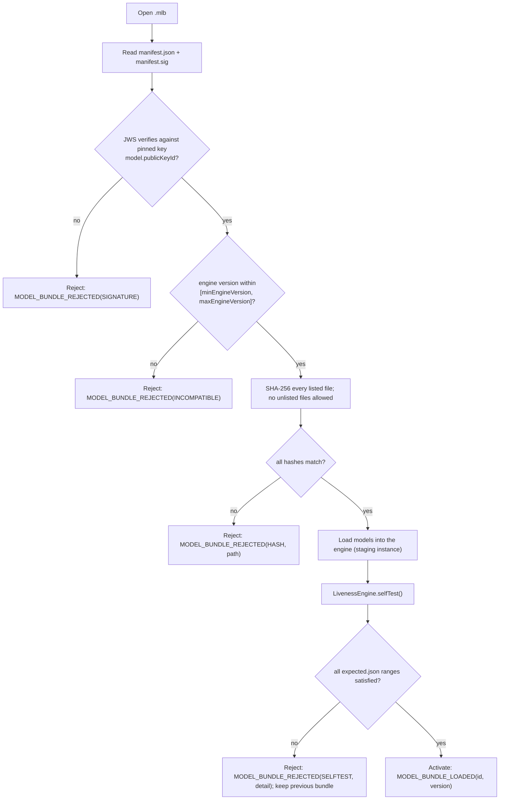

# 11 — Model lifecycle: packaging, versioning, verification, offline updates, rollback

Covers the bonus tasks "liveness model version management" and "secure
offline model updates". The `model-bundle` module implements the format
and verifier; the engines consume verified bundles only. Status: the
format and verifier are specified here; see the root README for the
module's implementation status.

## 1. Bundle format (`.mlb`)

A `.mlb` file is a ZIP archive:

```
<bundleId>-<version>.mlb
├── manifest.json
├── manifest.sig              # detached JWS over the canonical manifest
├── models/
│   ├── yunet_2023mar.onnx
│   ├── minifasnet_v2_2.7.onnx
│   ├── minifasnet_v1_4.0.onnx
│   ├── landmarks_106.onnx
│   ├── mobilefacenet_112.onnx
│   └── moire_lr.json          # small classifiers are JSON parameter files
├── calibration.json           # Platt parameters and expected-score tables per signal
├── selftest/
│   ├── live_01.jpg … live_08.jpg
│   ├── print_01.jpg … screen_04.jpg
│   └── expected.json          # score ranges per file per signal
└── LICENSES/
    ├── yunet.txt, minifasnet.txt, …
```

`manifest.json`:

```json
{
  "schemaVersion": "1.0",
  "bundleId": "vivid-desktop-onnx",
  "version": "1.2.0",
  "platform": "desktop-onnx",
  "minEngineVersion": "0.3.0",
  "maxEngineVersion": "0.x",
  "createdAt": "2026-10-20T10:00:00Z",
  "models": [
    {"path": "models/minifasnet_v2_2.7.onnx", "sha256": "…", "signal": "cnn_texture", "inputs": [[1,3,80,80]], "licence": "Apache-2.0"},
    {"path": "models/mobilefacenet_112.onnx", "sha256": "…", "signal": "identity", "inputs": [[1,3,112,112]], "licence": "see LICENSES/mobilefacenet.txt"}
  ],
  "calibration": {"sha256": "…"},
  "selftest": {"sha256": "…", "required": true},
  "notes": "Recalibrated S2 on corpus v3; no architecture change."
}
```

Self-test images are synthetic or from consenting team members under the
corpus consent, never from residents.

## 2. Verification at load



* The pinned public key is obtained from the MOSIP keymanager (alias
  `LIVENESS_MODEL_SIGNING`) and cached locally with the same protection as
  other client keys. There is no "trust on first use".
* Files are hashed as they are extracted to a temporary directory; nothing
  is written into the active bundle directory until verification succeeds
  (atomic rename).
* Zip-slip and size limits: paths must be relative and inside the bundle;
  total uncompressed size is capped (default 200 MB).
* A bundle that fails any step is left on disk under `rejected/` for
  diagnostics and never loaded.

## 3. Versioning and compatibility

* Bundles use semantic versioning. Patch: recalibration or self-test
  updates; minor: new or retrained model with the same inputs/outputs;
  major: changed inputs/outputs (requires a new engine version).
* `EngineInfo.modelBundleId/Version` is reported in every `LivenessResult`
  and audit event, so the server can see which bundle produced which
  decision.
* The compatibility matrix is the pair `[minEngineVersion,
  maxEngineVersion]` in the manifest, checked at load. The engine also
  declares which signal ids it can run; a bundle missing a model for an
  enabled signal disables that signal (weight 0) and audits
  `SIGNAL_UNAVAILABLE(id)` rather than failing the bundle, which is the
  graceful-degradation path.

## 4. Update channels

| Channel | Trigger | Transport | Verification |
|---|---|---|---|
| Online | Client sync notices a newer version at `model.updateUrl` (manifest-only HEAD, then download) | HTTPS through the client's existing sync, resumable | Section 2, identical |
| Offline (USB / local path) | Supervisor-only screen "Import model bundle" | File picker; the file is copied to a staging directory | Section 2, identical |
| Initial | Bundled with the installer / APK | Part of the package | Section 2, run at first start |

There is exactly one verifier; the channel is irrelevant to trust.

## 5. Rollback

* `model.keepPreviousBundles` (default 2) previous bundles are retained
  under `bundles/<id>/<version>/`.
* Automatic rollback: if the newly activated bundle fails self-test at a
  later start (for example after a corrupted disk write), the previous
  verified bundle is activated and `MODEL_BUNDLE_ROLLED_BACK(from, to,
  reason)` is audited.
* Manual rollback: one action in the supervisor diagnostics screen, also
  audited.
* Rollback never skips verification; the previous bundle is re-verified
  before activation.

## 6. Model provenance and licences

Models in a bundle must be listed with their licence in the manifest and
the licence text included under `LICENSES/`. Base models in the planned
desktop bundle:

| Model | Role | Source | Licence | Note |
|---|---|---|---|---|
| YuNet (2023mar) | face detection | OpenCV Zoo | MIT (`liveness-engine-onnx/models/LICENSE-yunet.txt`) | present in the repository |
| MiniFASNet V1SE / V2 | S1 anti-spoofing | Silent-Face-Anti-Spoofing (minivision) | Apache-2.0 | last layers fine-tuned on the consented corpus |
| 106-point landmark model | landmarks, pose | to be selected (candidates: PFLD, InsightFace 2d106det) | must be Apache-2.0/MIT | InsightFace *weights* are research-only; if used, retrain or select an alternative before shipping |
| MobileFaceNet | S7 embeddings | to be selected | permissive weights required | same caveat as above |
| Moiré and colour classifiers | S2, S3 | trained in this project | MPL-2.0 | small, JSON parameters |
| MediaPipe Face Detector / Landmarker | Android | Google | Apache-2.0 | downloaded by the Android build |

Research-only datasets (OULU-NPU, SiW, CASIA-FASD, CelebA-Spoof and
similar) are used for evaluation only where their terms allow, never for
training shipped weights, and never redistributed.

## 7. Audit events

`MODEL_BUNDLE_LOADED(id, version, engineVersion)`,
`MODEL_BUNDLE_REJECTED(id, version, reason, detail)`,
`MODEL_BUNDLE_ROLLED_BACK(from, to, reason)`, `SIGNAL_UNAVAILABLE(id)`.
