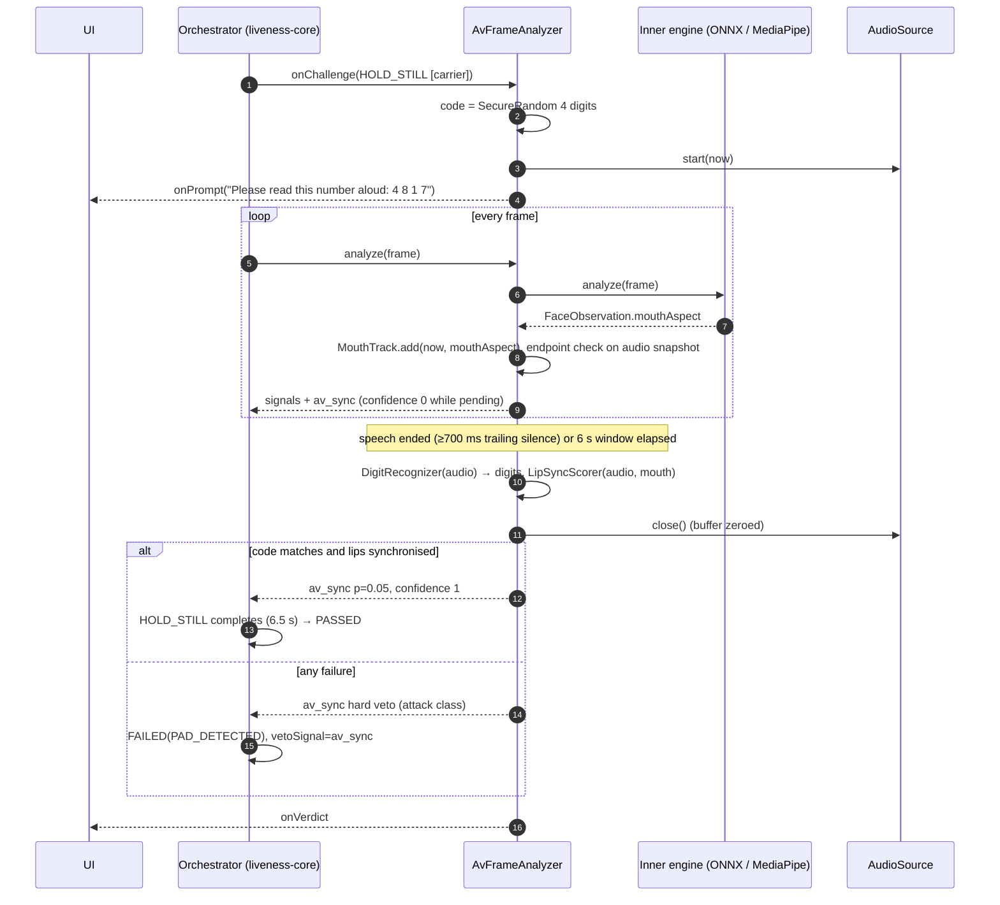

# 13 — Spoken-code audio-visual liveness

This document covers PLAN.md §17.8. The client shows a random four-digit code. The resident reads it aloud, and the
session passes this step only when two things hold:

* **(a) Code.** The digits recognised in the audio equal the code exactly.
* **(b) Synchrony.** Mouth opening, measured over time from the face landmarks, moves with the speech energy envelope.
  The peak cross-correlation must fall at a lag within ±200 ms, and it must beat the correlations at shuffled time
  offsets of the same utterance.

The code is random, so a replayed video gives the wrong digits. Both channels have to agree, so neither an audio-only
fake (a loudspeaker next to a photo) nor a face-only fake (a video of the person with no matching voice) passes. The
step needs no head movement or facial gesture, so it also serves as an accessibility path for residents who cannot
blink, smile or turn on request.

**Status: working, tested prototype in the `liveness-av` module.** It is exercised only with synthetic speech (TTS)
and synthetic mouth tracks. No real speaker has used it, and it is not yet wired into the Desktop or Android client UI.
The results and their caveats are in [`docs/testing/av-liveness.md`](../testing/av-liveness.md).

## 1. Components

| Class (`io.mosip.vivid.av…`) | Role |
|---|---|
| `SpokenCode` | Code drawn from `SecureRandom`: 4 independent uniform digits, 13.3 bits. `display()` gives `"4 8 1 7"`. |
| `audio.AudioSource` (SPI) | Microphone contract: 16 kHz mono 16-bit, `start(nowNanos)` stamps the first sample on the session clock, `snapshot()`, and `close()` must zero the buffer. |
| `audio.JavaSoundAudioSource` | Desktop microphone via `javax.sound` `TargetDataLine`, with an in-memory buffer capped at N seconds. |
| `audio.ArrayAudioSource`, `audio.WavReader` | File or array playback driven by a clock, for tests, evaluation and file-driven demos. |
| `asr.DigitRecognizer` (SPI), `asr.Recognition` | Spoken digits in one language → digit string plus per-word timing. |
| `asr.VoskDigitRecognizer`, `asr.VoskModels` | Offline Vosk (Kaldi) small models, Apache-2.0, decoding against a closed grammar of the ten digit words plus `[unk]`. |
| `asr.DigitLexicon` | Digit words for `en`, `hi`, `te`, `gu`. Each word was checked against the model vocabulary. |
| `sync.SpeechActivity` | 10 ms RMS energy, noise floor, voice-activity decision, end-of-utterance detection. |
| `sync.MouthTrack`, `sync.LipSyncScorer`, `sync.SyncConfig`, `sync.SyncResult` | Lip-audio synchrony test (§3). |
| `SpokenCodeVerifier`, `AvVerdict` | Combines (a) and (b) into one outcome. Both channels are always evaluated and reported. |
| `AvLivenessEngine`, `AvFrameAnalyzer` | Decorator around any `LivenessEngine`, which is the integration seam (§4). |
| `SpokenCodeListener`, `SpokenCodePrompt` | UI hook: shows the code, receives the verdict. |
| `AvConfig`, `AvSetup`, `SpokenCodeRequirement` | Configuration, a consistency check and the carrier hold time, and a client-side "the code was spoken" assertion on `LivenessResult`. |

The shipping code compiles to Java 11 bytecode like the other client modules. Its only new runtime dependencies are
`com.alphacephei:vosk:0.3.45` (25 MB jar with native `libvosk`) and JNA.

## 2. Flow



## 3. Decision rule

### 3.1 Channel (a): the code

`VoskDigitRecognizer` decodes the whole utterance with a closed grammar: the ten digit words of the language and
`[unk]`. With that grammar, the small models recognise digits far better than with open vocabulary. On the
`four, eight, one, seven` probe, free decoding produced "for eight when sam and" and the grammar produced
"four eight one seven". The recognised digit string must **equal** the code. There is no edit-distance tolerance:
allowing one wrong digit would raise the chance that an old recording passes from 1 in 10,000 to about 37 in 10,000
for substitutions alone.

### 3.2 Channel (b): synchrony (`LipSyncScorer`)

1. **Window.** From the first to the last voiced 10 ms frame (`SpeechActivity`), plus 300 ms on each side. A window
   shorter than 1.2 s is `INSUFFICIENT_VIDEO`.
2. **Grid.** 20 ms. Audio: frame RMS averaged per grid step, then smoothed over 3 steps. Mouth: linear interpolation
   of the per-frame `mouthAspect`. A gap of more than 250 ms between face samples, or missing samples in more than
   10 % of the window, gives `INSUFFICIENT_VIDEO`. Both series are z-normalised.
3. **Peak.** The highest Pearson r over lags of −200…+200 ms. A negative lag means the mouth leads the audio, which is
   normal for speech: lips open before sound comes out.
4. **Shuffled-offset baselines.** 24 circular shifts of the mouth series, spread over [500 ms, window − 500 ms]. Each
   shift gets the same peak search, so the baseline is chance-level correlation **for this utterance and this face**,
   including the rhythm of the digits. This baseline is what separates "lips that move while someone talks" from
   "lips that move with this speech".
5. **Pass** (defaults in `SyncConfig`):
   * mouth sd ≥ 0.015 in `mouthAspect` units, else `STATIC_MOUTH`;
   * peak ≥ 0.6;
   * z = (peak − baseline mean) / baseline sd ≥ 2.0;
   * peak − max(baselines) ≥ 0.1.

   The defaults were chosen on synthetic data (§9, and the operating-point table in the test report). They must be
   recalibrated on real speakers.

### 3.3 Outcomes

| `AvVerdict.Outcome` | When | Attack class reported with the veto |
|---|---|---|
| `PASS` | (a) and (b) | — (av_sync p = 0.05, confidence 1) |
| `NO_SPEECH` | no voiced audio within 6 s | `UNKNOWN` |
| `CODE_MISMATCH` | digits ≠ code | `VIDEO_REPLAY` |
| `STATIC_MOUTH` | code heard, mouth still | `PRINT` |
| `OUT_OF_SYNC` | mouth moves but not with the speech | `DEEPFAKE` |
| `INSUFFICIENT_VIDEO` | too few face frames during the utterance | `UNKNOWN` |
| `AUDIO_UNAVAILABLE` | microphone cannot be opened (fail-closed default) | `UNKNOWN` |
| `ENGINE_ERROR` | recogniser threw | `UNKNOWN` |

Every failure surfaces as `FAILED(PAD_DETECTED)` with `vetoSignal = av_sync`. The UI shows the same generic retry text
as for any PAD failure (UX spec: never PAD-specific copy). Audit and `LivenessResult.attackClass` carry the class. A
silent or non-complying resident is therefore recorded as an `ATTACK` decision, not `NOT_LIVE`. The frozen SPI gives
an engine no "challenge failed" channel; see §4.3.

## 4. Integration: why there is no `SPEAK_CODE`, and the seam used instead

### 4.1 Can `ChallengeType.SPEAK_CODE` be added without breaking the frozen SPI?

Not safely. Adding an enum constant compiles, but it changes behaviour for existing consumers of `liveness-api`. The
repository is explicit that this SPI is frozen (CONTRIBUTING.md, PR template). What would break:

| Consumer | Effect of a new constant |
|---|---|
| `liveness-engine-onnx` `OnnxLivenessEngine.info()` | Builds `supportedChallenges` from `EnumSet.allOf(ChallengeType.class)` minus a few, so it would advertise SPEAK_CODE without verifying it. |
| `liveness-core` `ActionDetectors.create` | `default: throw new IllegalArgumentException("no detector for …")`. If a policy put SPEAK_CODE in a pool, the orchestrator would throw on the feeding thread. |
| `ChallengeType` attributes | The enum has only `revealsDepth` and `requiresMotorAbility`. Nothing marks "needs a microphone", so `ChallengeSelector` could draw it on a device without one. |
| `SessionState` / `Challenge` | No field for a challenge argument. The UI cannot learn the code through the frozen state object. |
| Android Pigeon bridge (`LivenessPigeon.kt`, `liveness_pigeon.dart`) | Generated code that maps enums by index. It needs regeneration on both sides, plus an APK rebuild. |
| `demo-desktop` (`UxCopy`, `ResponsiveSubjectSource`), Desktop/Flutter overlays, TLA+ model | Switches on the type, an icon per type, a message key per type (`LivenessMessagesTest` checks every constant has copy). |

### 4.2 Seam used: the engine decorator and a carrier challenge

`AvLivenessEngine` wraps any engine. Its analyzer passes every frame through and adds one signal, `av_sync`. It uses
two hooks that the frozen SPI already provides:

* `FrameAnalyzer.onChallenge(Challenge)`: "tells the analyzer which challenge is active … may be ignored". When the
  issued type is a **carrier** (`AvConfig.carriers()`, default `HOLD_STILL`), the analyzer starts a spoken-code
  round.
* `SignalScore` with `hardVeto`: the orchestrator already fails a session on any enabled vetoing signal. An unknown
  signal id has weight 1.0 by default (`LivenessPolicy.signalWeight`), so `av_sync` is honoured without any policy
  change. Setting its weight to 0 disables it, and `SpokenCodeRequirement` then reports that the requirement was not
  met.

`HOLD_STILL` is the carrier for three reasons:
* speaking moves the jaw but not the face centre or the head pose, which is what `HoldStillDetector` watches;
* `requiresMotorAbility() == false`;
* it is already in the default accessibility pool.

**Fail-closed timing.** `AvSetup.carrierThresholds()` raises `holdStillMillis` to the response window plus 500 ms
(6.5 s by default). The analyzer always decides by the end of the window, on the orchestrator's own `TimeSource`.
`analyze()` runs before the orchestrator updates the action detector, and the hold window can only start at or after
the challenge is issued. So the verdict (pass or veto) reaches fusion before `HOLD_STILL` can complete. If another
challenge is issued while a round is still open, the analyzer decides immediately on what it has captured, and an
incomplete round fails. `AvSetup.check()` lists wiring that would break this guarantee: hold time too short, challenge
timeout ≤ hold time, `HOLD_STILL` not in the pool, or `OPEN_MOUTH`/`SMILE` watched as unprompted actions.

**UI.** The frozen `SessionState` cannot carry the code. The client registers a `SpokenCodeListener` on the engine
and overlays the prompt (`SpokenCodePrompt.MESSAGE_KEY`) while the carrier challenge is active. The copy entries are:

| Platform | Key | en | fr | ar |
|---|---|---|---|---|
| Desktop (`liveness*.properties`, `LivenessMessages.SPEAK_CODE`) | `liveness.challenge.speak_code` | Please read this number aloud: {0} | Veuillez lire ce nombre à voix haute : {0} | يرجى قراءة هذا الرقم بصوت عالٍ: {0} |
| Flutter (`l10n/liveness_*.arb`) | `liveness_challenge_speak_code` | Please read this number aloud: {code} | Veuillez lire ce nombre à voix haute : {code} | يرجى قراءة هذا الرقم بصوت عالٍ: {code} |

The argument is `SpokenCode.display()` ("4 8 1 7"). Spacing the digits makes screen readers and residents read them
one at a time.

**Wiring (Desktop):**

```java
AvConfig cfg = AvConfig.builder().languageTag("hi").build();
DigitRecognizer asr = VoskDigitRecognizer.forLanguage("hi");               // model from ~/.cache/vivid-av/models
AvLivenessEngine engine = new AvLivenessEngine(onnxEngine, cfg, asr,
        () -> new JavaSoundAudioSource(10), TimeSource.system(), new SecureRandom());
engine.addListener(overlay);                                              // shows the code, hides it on verdict
ActionThresholds t = AvSetup.carrierThresholds(ActionThresholds.defaults(), cfg);
LivenessSessionFactory f = new LivenessSessionFactory(engine, policies, audit, metrics, TimeSource.system(), new SecureRandom(), t);
// assisted capture: accessibilityPool = {HOLD_STILL}, so the spoken code is the active evidence
```

### 4.3 Proposed SPI extension (for an issue; not implemented)

1. Append `SPEAK_CODE(false, false)` to `ChallengeType` and add `requiresAudio()`. `ChallengeSelector` would exclude
   such types unless `DeviceCapabilities` reports a microphone.
2. Add an optional `Map<String,String> arguments()` to `Challenge`, filled by the orchestrator (`code=4817`), so the
   UI can render the prompt from `SessionState` alone.
3. Add a core `ExternalChallengeVerifier` hook: an `ActionDetector` whose status comes from the engine, for example
   from a `ChallengeEvidence` record on `FrameAnalysis`. A spoken-code failure would then be
   `ACTIVE_CHALLENGE_FAILED` rather than `PAD_DETECTED`, and the hold-time coupling of §4.2 would go away.
4. Replace `EnumSet.allOf` in engines with explicit lists, regenerate Pigeon, and add the type to the TLA+ model's
   challenge alphabet.

## 5. Languages

| Tag | Lexicon | Vosk model | Exercised with | Result in short |
|---|---|---|---|---|
| `en` | zero/oh … nine | small-en-us-0.15 | Piper lessac, Piper L2-ARCTIC (4 Hindi-L1 speakers), eSpeak en-us | works on the neural voices (57/60 digit strings exact) |
| `en-IN` | same | small-en-in-0.4 | same L2-ARCTIC and eSpeak voices | poor on these voices (9/60): mostly dropped digits; use `en` |
| `hi` | शून्य एक दो … नौ (+ पाँच, छः, छे) | small-hi-0.22 | Piper pratham and priyamvada, eSpeak hi | works on the neural voices (23/24); eSpeak 4/12 |
| `te` | సున్నా ఒకటి … తొమ్మిది | small-te-0.42 | Piper maya and venkatesh, eSpeak te | partial: 14/24 on the neural voices, mostly one digit dropped; eSpeak 0/12 |
| `gu` | શૂન્ય એક … નવ | small-gu-0.42 | eSpeak gu only (no Piper voice exists) | not usable as tested: 2/12; the eSpeak voice is marked "test" quality |

So, of the three Indian languages required, **Hindi** works on synthetic neural speech, **Telugu** works partly and
**Gujarati** was exercised but not shown to work. Whether the Telugu and Gujarati failures come from the TTS or from
the small models is unknown, because no real speech was available. Tamil, Kannada, Malayalam, Marathi and Bengali
have no Vosk small model. `DigitRecognizer` is an interface, so a better model (a Vosk big model or another offline
engine) can be plugged in per language.

## 6. Accessibility

* With assisted capture and `accessibilityPool = {HOLD_STILL}`, the spoken code is the **only** active challenge. The
  resident looks at the camera and reads four digits. No blink, smile or head turn is needed.
  `AvOrchestratorEndToEndTest` runs exactly this configuration.
* The prompt is visual. An operator may read it out for a resident with low vision, because what is checked is that
  the person on camera says the digits in sync with their lips, not who chose them. A resident who cannot speak
  cannot use this path and stays on the existing exception flow (`FALLBACK_TO_EXCEPTION_FLOW`).
* The response window is 6 s. Speaking ends the round early (after 700 ms of trailing silence). The carrier then holds
  for the remaining time up to 6.5 s, which is a known UX cost of the seam (§4.2).

## 7. Privacy: audio is never stored

* Capture runs only between the prompt and the verdict, at most `responseWindowMillis` (6 s). The buffer is in memory
  and capped (`JavaSoundAudioSource(maxSeconds)`).
* No audio is ever written to disk, logged, put in audit, in `LivenessResult`, in the evidence hash, or sent anywhere.
  Recognition runs offline in-process.
* After the verdict, the analyzer zeroes every snapshot (`AudioClip.wipe()`), and `AudioSource.close()` zeroes the
  capture buffer. `VoskDigitRecognizer` zeroes its copy after decoding. Tests assert the wipe.
* What leaves the module is the `AvVerdict`: outcome, code, recognised digits, synchrony numbers and onset time. The
  application log records only the outcome and the sync status, not the digits. The fused result keeps only the
  `av_sync` attack probability.
* There is no voice biometric: no speaker embedding is computed or compared. The audio cannot be used to identify
  anyone after the session.
* The DPIA in [09-security-privacy](09-security-privacy.md) should add the microphone as a sensor. It needs notice to
  the resident, capture limited to the prompt window, a visible microphone indicator, and the guarantees above.

## 8. Threat model

| Attack | What stops it | Residual risk |
|---|---|---|
| Replay of a video of the person (any earlier session or other recording) | Code mismatch: a recording says some other 4 digits; P(match) = 10⁻⁴ per attempt, and attempts are capped by `maxRetries` | None beyond brute force |
| Photo, print or mask plus a loudspeaker playing TTS of the shown code | `STATIC_MOUTH`: the face does not move with the speech | A mask with a moving jaw is not modelled |
| Dubbing: correct code synthesised in real time, lips from another recording of the person | Synchrony against shuffled baselines | **Weak**: lips from another digit utterance of the same voice passed 30 % of the time on synthetic data (35 of the ~117 presentations where the code was heard correctly); digit rhythm is similar across codes |
| Lips shifted in time (a lagging deepfake, or audio and video from separate pipelines) | Lag must be within ±200 ms | 2 of 216 passed on synthetic data |
| Real-time lip-synced deepfake (talking-head model driven by TTS of the code) | Only synchrony, plus the passive PAD signals and identity continuity that keep running | **Not addressed by this step.** A good real-time lip-sync model is designed to pass exactly this test |
| Accomplice off camera reads the code while the person on camera talks | Two voices: the recogniser hears extra or wrong digits; the envelope does not follow the on-camera lips | 1 of 216 passed on synthetic data |
| Silence or a refusal | `NO_SPEECH` at the 6 s window | — |
| Injection: virtual camera plus virtual microphone | Out of scope for this step. The audio path is no more trusted than the unsigned preview stream ([02-frame-streaming](02-frame-streaming.md)) | Relies on device trust |
| Attacker reads the code off the screen | By design: the code is meant to be seen. The defence is that the response must come live, within 6 s, from the face on camera | — |

## 9. Limits (read before relying on it)

* **Synthetic only.** All speech is TTS (Piper neural voices and eSpeak), and all mouth tracks are synthetic. Live
  tracks are driven by the speech envelope itself, with random articulation gain and noise. Real lip aperture
  correlates with the envelope much less well; r ≈ 0.3–0.6 is typical in the audio-visual speech literature. Real
  bona fide synchrony peaks will therefore be lower than the 0.8–0.95 measured here, and the 0.6 peak threshold may
  reject real people. Calibrate on a consented corpus before use.
* **Mouth measurement.** On Desktop, `mouthAspect` comes from the ONNX engine's image heuristic: the height of a dark
  band between YuNet's two mouth corners. It has never been checked against speech. On Android it is MediaPipe
  `jawOpen`, which is more plausible but also untested here. `minMouthStd` is in `mouthAspect` units and is
  engine-specific.
* **Noise.** A second voice in the room breaks recognition. In the `BACKGROUND_TALKER` case, a second voice 12 dB
  quieter than the resident caused 189 of 216 bona fide presentations to fail on code mismatch. A busy enrolment hall
  is exactly this situation.
* **Recognition.** Exact match on 4 digits leaves no slack. Telugu and Gujarati as tested, and the Indian English small
  model, are not good enough.
* **Not in the clients yet.** No Desktop overlay or Android `AudioRecord` source is wired. `JavaSoundAudioSource`
  works only on desktop JVMs, and Android would need `vosk-android` plus an `AudioRecord`-backed `AudioSource`.
* **UX cost of the seam.** The carrier holds 6.5 s even when the resident finished speaking at 3 s.
* **Thread.** Recognition runs synchronously on the feeding thread at end of speech. It takes 50–70 ms on this
  machine's CPU, which is a one-frame stall.
* **Capture latency** of real microphones (20–100 ms of input buffering) was not measured. The ±200 ms lag window is
  meant to absorb it.
