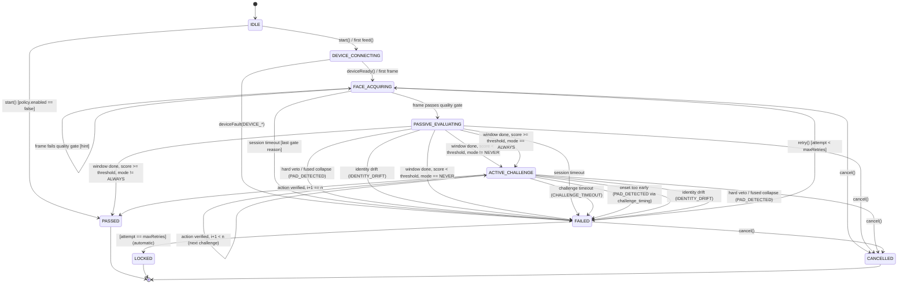

# Liveness session state machine

This page describes `io.mosip.vivid.core.session.LivenessOrchestrator`, the only component that knows about
policy, retries, timeouts and transitions (PLAN.md §2.3). Engines score frames. The UI renders `SessionState`
(phase, hint, current challenge, progress) and never decides anything itself.

## Diagram

Device faults (`deviceFault`, a `DISCONNECTED` or `FAILED` health event, or the stream ending) fail the current
attempt from any live phase. `DEGRADED` and `RECONNECTING` only change the hint.

## Transition table

"Live phase" means `FACE_ACQUIRING`, `PASSIVE_EVALUATING` or `ACTIVE_CHALLENGE`. `n` is the length of the drawn
challenge sequence. All times come from the injected `TimeSource`. Device frame timestamps are never trusted.

| # | From | To | Trigger and guard | Audit event(s) | UI hint |
|---|------|----|-------------------|----------------|---------|
| 1 | IDLE | DEVICE_CONNECTING | `start()`, or the first `feed()`; `policy.enabled` | `SESSION_STARTED(attempt=1, retry=false)` | `NONE` |
| 2 | IDLE | PASSED | `start()`; `!policy.enabled` (result `LIVE`, failure `POLICY_DISABLED`) | `SESSION_STARTED`, `SESSION_PASSED(policyDisabled=true)` | `CAPTURED_OK` |
| 3 | DEVICE_CONNECTING | FACE_ACQUIRING | `deviceReady()`, or a frame arrives | none | `CENTER_FACE` |
| 4 | DEVICE_CONNECTING | FAILED | `deviceFault(reason)`, or `tick()` after `sessionTimeoutMillis` with no device (`DEVICE_CONNECTION_FAILURE`) | `DEVICE_FAULT(kind)`, `SESSION_FAILED(reason)` | `DEVICE_DISCONNECTED` |
| 5 | FACE_ACQUIRING | FACE_ACQUIRING | frame fails the quality gate (0 faces / more than 1 / off-centre / too small or large / quality below `minFaceQuality`) | none | `LOOK_AT_CAMERA`, `ONLY_ONE_FACE`, `CENTER_FACE`, `MOVE_CLOSER`, `MOVE_BACK`, `IMPROVE_LIGHTING`, `HOLD_STILL` |
| 6 | FACE_ACQUIRING | PASSIVE_EVALUATING | first frame that passes the gate; the passive window starts | none | `CHECKING_LIVENESS` |
| 7 | FACE_ACQUIRING | FAILED | `sessionTimeoutMillis` elapsed (frame or `tick()`) | `SESSION_FAILED(FACE_NOT_DETECTED / MULTIPLE_FACES / POOR_FACE_QUALITY)` | `RETRY_AVAILABLE` / `TRY_AGAIN` |
| 8 | PASSIVE_EVALUATING | FAILED | a signal vetoes (`hardVeto`, or `p >= padHardThreshold` with confidence >= 0.5) | `PAD_DETECTED(attackClass, fusedScore, vetoSignal)`, `SESSION_FAILED(PAD_DETECTED)` | `RETRY_AVAILABLE` |
| 9 | PASSIVE_EVALUATING | FAILED | fused attack probability >= `padHardThreshold` after `passiveMinFrames` (veto signal `fusion`) | `PAD_DETECTED`, `SESSION_FAILED(PAD_DETECTED)` | `RETRY_AVAILABLE` |
| 10 | PASSIVE_EVALUATING | FAILED | identity drift on 3 consecutive frames; `requireIdentityContinuity` | `IDENTITY_DRIFT(distance, threshold)`, `SESSION_FAILED(IDENTITY_DRIFT)` | `RETRY_AVAILABLE` |
| 11 | PASSIVE_EVALUATING | PASSED | at least `passiveMinFrames` and `passiveWindowMillis`; smoothed score >= `passiveThreshold`; mode is not `ALWAYS` | `PASSIVE_PASSED`, `SESSION_PASSED(scores, evidenceHash)` | `CAPTURED_OK` |
| 12 | PASSIVE_EVALUATING | ACTIVE_CHALLENGE[0] | window done; score < threshold and mode is not `NEVER`, or mode is `ALWAYS`; non-empty sequence | `PASSIVE_BELOW_THRESHOLD` or `PASSIVE_PASSED`, then `CHALLENGE_ISSUED(type, index, total, nonce)` | `PLEASE_CONTINUE` |
| 13 | PASSIVE_EVALUATING | FAILED / PASSED | window done; mode is `NEVER` with score < threshold, or the drawn sequence is empty (falls back to the passive verdict) | `PASSIVE_BELOW_THRESHOLD`, `SESSION_FAILED(LIVENESS_BELOW_THRESHOLD)` | `RETRY_AVAILABLE` |
| 14 | PASSIVE_EVALUATING | FAILED | `sessionTimeoutMillis` elapsed | `SESSION_FAILED(SESSION_TIMEOUT)` | `RETRY_AVAILABLE` |
| 15 | ACTIVE_CHALLENGE[i] | ACTIVE_CHALLENGE[i+1] | action verified; latency inside the window or only mildly suspicious; i+1 < n | `CHALLENGE_PASSED(latencyMs, durationMs)`, `CHALLENGE_ISSUED` | `PLEASE_CONTINUE` |
| 16 | ACTIVE_CHALLENGE[n-1] | PASSED | last action verified | `CHALLENGE_PASSED`, `SESSION_PASSED` | `CAPTURED_OK` |
| 17 | ACTIVE_CHALLENGE | FAILED | onset before the prompt or below `minActionLatencyMillis / 2` (S6 hard veto, class `VIDEO_REPLAY`); timing weight > 0 | `PAD_DETECTED(vetoSignal=challenge_timing)`, `SESSION_FAILED(PAD_DETECTED)` | `RETRY_AVAILABLE` |
| 18 | ACTIVE_CHALLENGE | FAILED | `challengeTimeoutMillis` elapsed since the prompt (frame or `tick()`) | `CHALLENGE_TIMEOUT(type, index)`, `SESSION_FAILED(CHALLENGE_TIMEOUT)` | `RETRY_AVAILABLE` |
| 19 | ACTIVE_CHALLENGE | FAILED | passive veto or fused collapse while the challenge runs (passive scoring never stops) | `PAD_DETECTED`, `SESSION_FAILED(PAD_DETECTED)` | `RETRY_AVAILABLE` |
| 20 | ACTIVE_CHALLENGE | FAILED | identity drift on 3 consecutive frames | `IDENTITY_DRIFT`, `SESSION_FAILED(IDENTITY_DRIFT)` | `RETRY_AVAILABLE` |
| 21 | ACTIVE_CHALLENGE | FAILED | `sessionTimeoutMillis` elapsed; the open challenge is logged as `TIMEOUT` | `SESSION_FAILED(SESSION_TIMEOUT)` | `RETRY_AVAILABLE` |
| 22 | any live phase | FAILED | `deviceFault(DEVICE_* / CAMERA_*)`, a bridge `DISCONNECTED` or `FAILED` health event, or the stream ended | `DEVICE_FAULT(kind)`, `SESSION_FAILED(reason)` | `DEVICE_DISCONNECTED` |
| 23 | any live phase | same | `deviceReconnecting()` (health `DEGRADED` or `RECONNECTING`) | `DEVICE_FAULT(RECONNECTING)` | `DEVICE_RECONNECTING` |
| 24 | any live phase | FAILED | the engine threw (`ENGINE_ERROR`) or returned null (`INVALID_FRAME_DATA`) | `SESSION_FAILED(reason)` | `RETRY_AVAILABLE` |
| 25 | FAILED | FACE_ACQUIRING | `retry()`; attempt < `maxRetries`. Resets fusion, the drift streak (the identity anchor is kept) and the analyzer | `SESSION_STARTED(attempt, retry=true)` | `TRY_AGAIN` |
| 26 | FAILED | LOCKED | immediately after the failure that used the last attempt | `MAX_RETRIES_REACHED(action=onMaxRetries)` | `MAX_RETRIES_REACHED` |
| 27 | any non-terminal | CANCELLED | `cancel()` or `close()`; an open challenge is logged as `ABORTED` | `SESSION_FAILED(CANCELLED)` | `NONE` |

`retry()` returns `false` in every phase except `FAILED` with attempts remaining. `PASSED`, `LOCKED` and `CANCELLED`
are terminal. `feed()` and `tick()` return the unchanged state there.

## Decisions in the result

| Failure reason | `LivenessResult.Decision` |
|----------------|---------------------------|
| none (passed) | `LIVE` |
| `POLICY_DISABLED` (passed without checks) | `LIVE` with `failure = POLICY_DISABLED` |
| `PAD_DETECTED`, `IDENTITY_DRIFT` | `ATTACK` |
| `DEVICE_UNAVAILABLE`, `DEVICE_CONNECTION_FAILURE`, `CAMERA_UNAVAILABLE`, `INVALID_FRAME_DATA`, `ENGINE_ERROR` | `ERROR` |
| `CANCELLED` | `CANCELLED` |
| everything else | `NOT_LIVE` |

Every result carries `evidenceHash`. This is the SHA-256 (hex) of
`v1|sessionId|workflow|decision|sorted signal scores|challenge log|nonceHex|policyVersion|modelBundleVersion`.
Recompute it with `EvidenceHash.verify(result)`.

## Signals inside the state machine

* **Passive fusion** (`ScoreFusion`) runs on every frame that passes the gate, in every live phase. It uses
  weighted log-odds normalised by the total weight, then an EMA (alpha 0.25 by default). The quality signal is
  never fused.
* **S6 challenge timing** (`ChallengeTiming`) is evaluated when an action completes, and only for actions whose onset
  is meaningful (not `HOLD_STILL`). A non-veto score is pinned into fusion for the rest of the attempt.
* **S7 identity continuity** (`IdentityContinuity`) is veto-only. Its score appears in the result but is never
  fused, because a matching identity is not evidence of liveness (a photo is identity-consistent).
* **Action detectors** (`ActionDetectors`) all require a neutral observation after the prompt before an action can
  start. This is the anti-replay rule.

## Threading

One lock guards all state. `feed()` may be called from the device delivery thread and `tick()` from a timer.
Listeners run synchronously under the lock and must not call back into the session. `FrameSourceBridge` therefore
stops the device source on a separate executor.
